<div align="center">

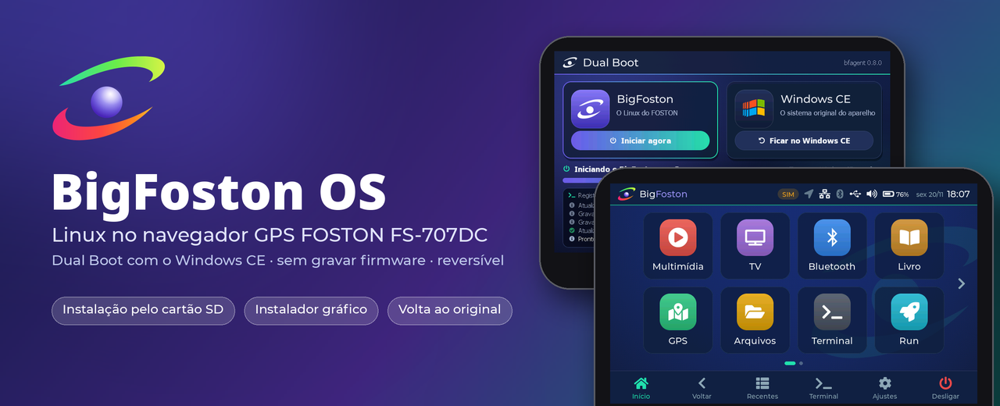

# BigFoston OS

**Um Linux completo para o navegador GPS FOSTON FS-707DC, em Dual Boot com o Windows CE original.**
**Instala pelo cartão SD, sem gravar firmware, sem abrir o aparelho e com volta garantida.** 🐧

[](https://github.com/ruscher/big-fostonos/releases/latest)


[](LICENSE)

[⬇️ Baixar](https://github.com/ruscher/big-fostonos/releases/latest) •
[🚀 Instalar](#-instalação-em-3-etapas) •
[📟 Compatíveis](#-modelos-compatíveis) •
[🔙 Voltar ao original](#-voltar-ao-original) •
[🔬 Técnico](#-como-funciona) •
[🛟 Problemas](docs/instalacao/07-solucao-de-problemas.md) •
[📘 Guia completo](docs/instalacao/README.md)

</div>

---

## ✨ O que é

O BigFoston OS transforma um navegador GPS de 2010 (MediaTek MT3351, Windows CE 5.0) num
aparelho Linux moderno, com interface de toque própria:

<table>
<tr>
<td width="50%">

- 🗺️ **Big GPS**: mapa offline do Brasil, rotas, voz, radares e limites de velocidade
- 🎵 **Multimídia**, 📖 Livros, 🖼️ Galeria, 📁 Arquivos, 💻 Terminal
- 🔵 **Bluetooth**: música e internet do celular, **Telefone** com contatos e mensagens
- 📺 **TV digital** (ISDB-T 1seg) e 📻 **transmissor FM**
- 🎮 **Big Remote Play**: os jogos do PC na tela do FOSTON, com som e controle Bluetooth
- 🔀 **Dual Boot**: a cada ligada, BigFoston OS ou o GPS original

</td>
<td width="50%">

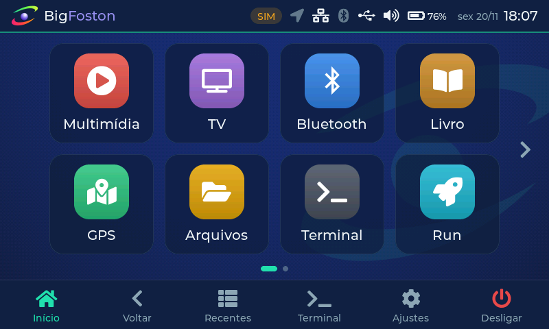

</td>
</tr>
</table>

| 🪟 Foston Glass | 🗺️ Big GPS | 📞 Telefone | 📺 TV |
|:-:|:-:|:-:|:-:|
| 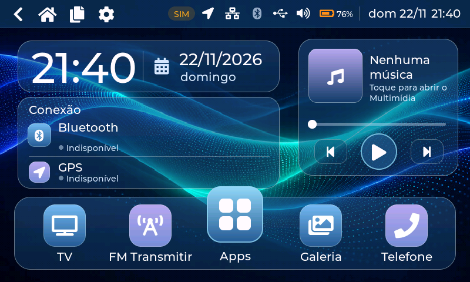 | 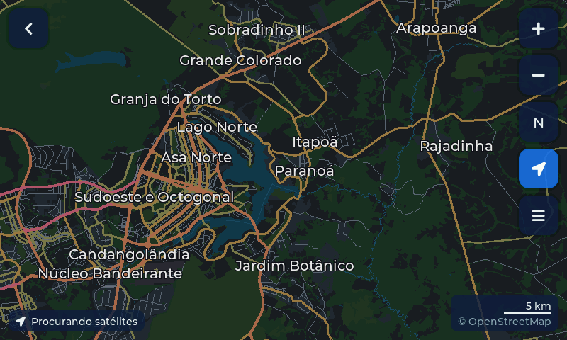 | 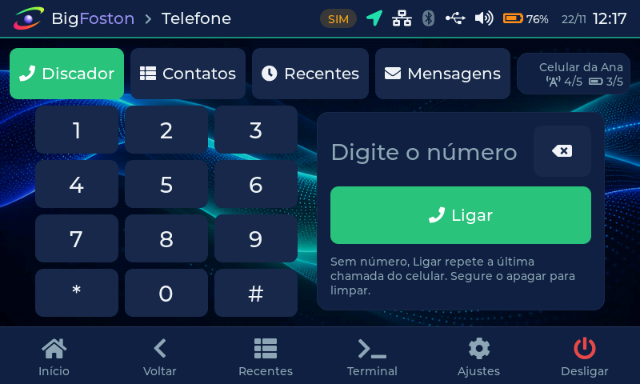 | 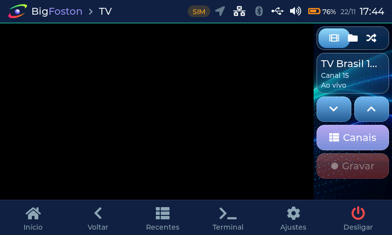 |

---

## 🚀 Instalação em 3 etapas

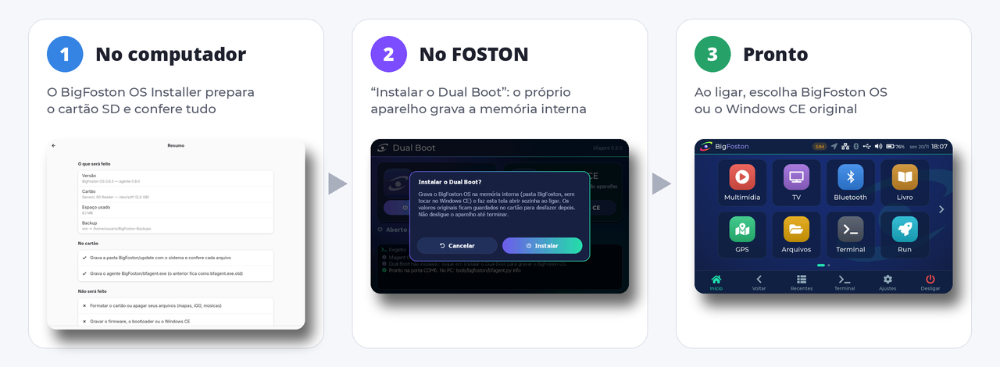

### Você vai precisar

| | | |
|:-:|---|---|
| 📟 | **FOSTON FS-707DC** carregado | [confira o modelo](docs/instalacao/01-modelos-compativeis.md#como-conferir-o-seu-aparelho) |
| 💻 | Computador com **Linux** (GTK 4.12+, Libadwaita 1.5+) | BigLinux, Manjaro, Arch, Fedora 40+, Ubuntu 24.04+ |
| 🃏 | **Leitor de cartões SD** e o cartão (FAT32, até 32 GB) | o instalador não apaga nada do cartão |
| ⏱️ | **~15 minutos** | |

### 1️⃣ No computador: preparar o cartão

```bash
git clone https://github.com/ruscher/big-fostonos.git
cd big-fostonos/installer/packaging/arch && makepkg -si     # BigLinux/Manjaro/Arch
# outras distribuições: big-fostonos/installer/bigfoston-installer
```

Baixe o `BigFoston-OS-FS707DC-<versão>.zip` em
[**Releases**](https://github.com/ruscher/big-fostonos/releases/latest), abra o
**BigFoston OS Installer** e toque em **Instalar BigFoston OS**:

| Início | Versão conferida | Só cartões seguros | Resumo |
|:-:|:-:|:-:|:-:|
| 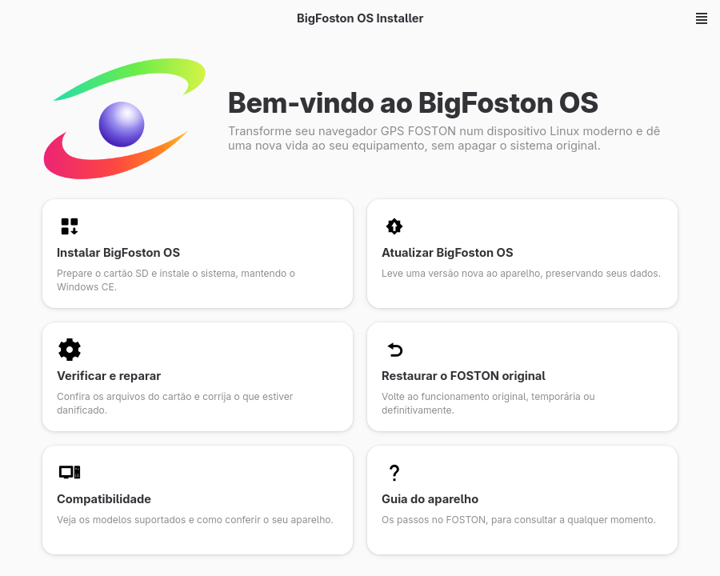 | 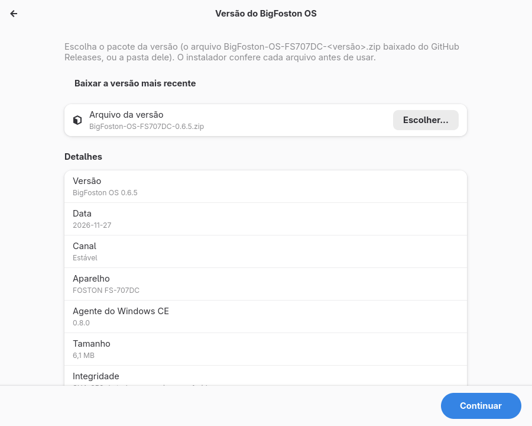 | 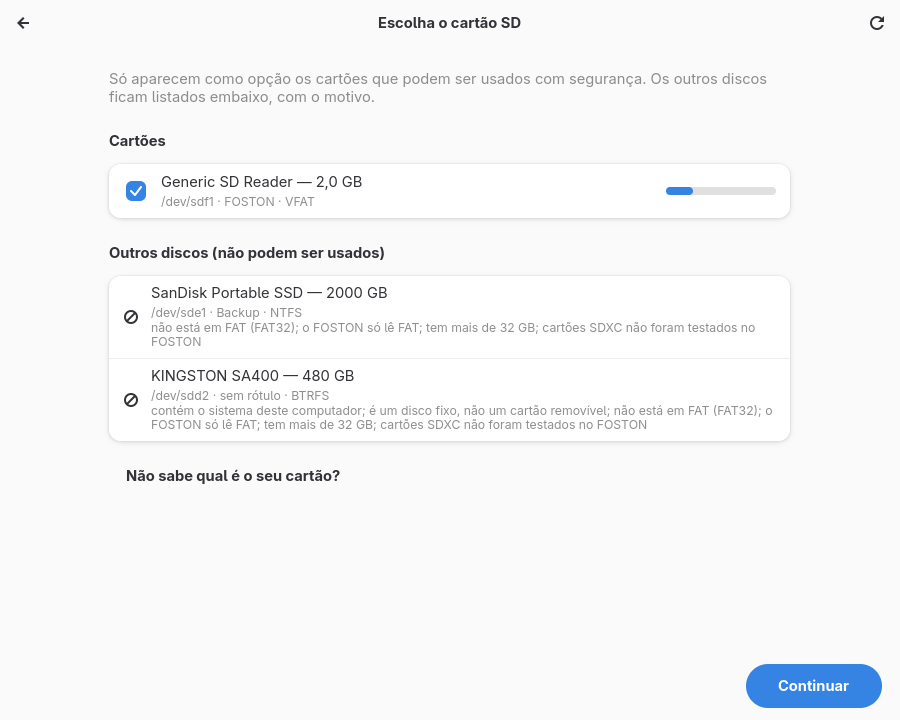 | 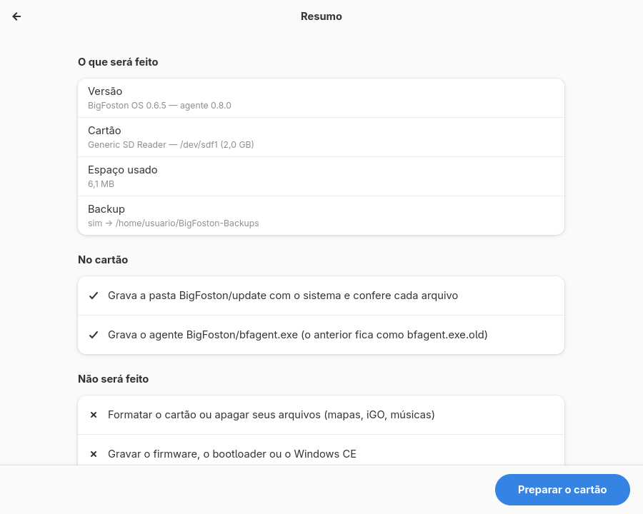 |

O instalador confere o SHA-256 de cada arquivo do pacote, só oferece volumes removíveis em
FAT, faz backup, grava numa **transação** (relendo cada arquivo do próprio cartão antes de
confirmar) e ejeta. ➜ [passo a passo com todas as telas](docs/instalacao/03-preparar-o-cartao.md)

### 2️⃣ No FOSTON: instalar o Dual Boot

1. Cartão no FOSTON (desligado) → ligue.
2. **Ajustes → Caminho da navegação**: **anote o caminho atual do GPS** e escolha
   **BigFoston → bfagent.exe** no cartão.
3. Toque em **Navegação** → **Instalar o Dual Boot** → **Instalar**. Não desligue (~1 min).

| Aberto pelo cartão | Confirmação | Instalado |
|:-:|:-:|:-:|
| 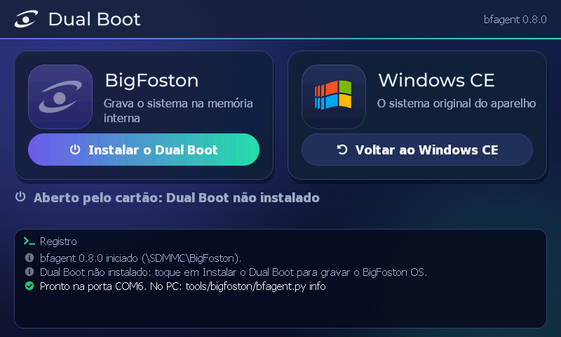 | 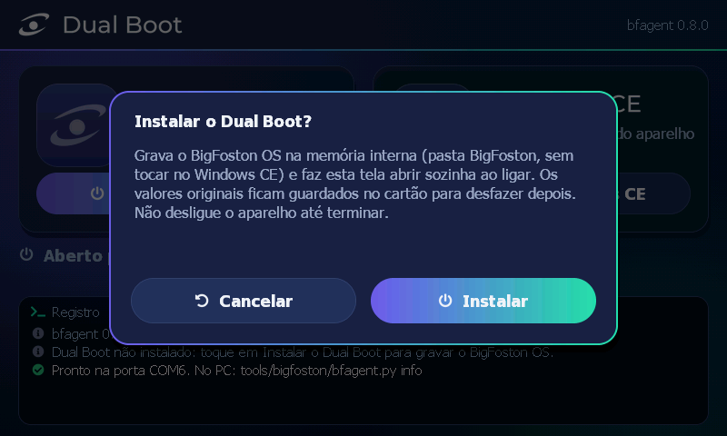 | 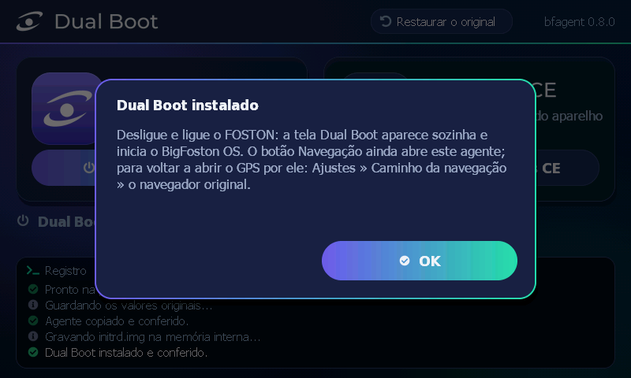 |

➜ [o que cada toque faz](docs/instalacao/04-instalar-no-foston.md)

> 🧪 **Transparência:** o botão “Instalar o Dual Boot” (agente 0.8.0) é novo e ainda não rodou
> no aparelho; ele junta peças já validadas no FOSTON real (atualização pelo cartão, início
> automático, tela Dual Boot). O caminho validado no aparelho é a
> [instalação pelo cabo USB](docs/instalacao/08-instalacao-avancada-usb.md).

### 3️⃣ Pronto: escolha ao ligar

Desligue e ligue: a tela **Dual Boot** conta 12 s e inicia o BigFoston OS. Toque em
**Ficar no Windows CE** para usar o GPS original.

<p align="center">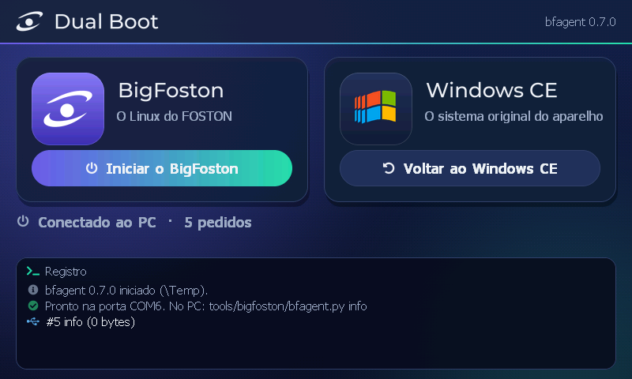</p>

---

## 📟 Modelos compatíveis

| Aparelho | Estado |
|---|---|
| **FOSTON FS-707DC** (MT3351, Windows CE 5.0 build 1400, `APOLLO`/`MTK`, 7" 800×480) | ✅ compatível, testado em hardware real |
| Outros modelos FOSTON e outros navegadores com MT3351 | ❓ não testados: o instalador recusa |
| Navegadores com outro processador | ⛔ incompatíveis |

➜ [como conferir o seu e o hardware em detalhe](docs/instalacao/01-modelos-compativeis.md)

---

## 🔙 Voltar ao original

O Windows CE, o bootloader e o firmware **nunca são alterados**. Três níveis:

| | Como |
|:-:|---|
| **Usar o CE agora** | na contagem, toque em **Ficar no Windows CE** |
| **Desativar o BigFoston OS** | tela Dual Boot → **Restaurar o original** → e o Caminho da navegação de volta ao GPS anotado |
| **Remover tudo** | no instalador: **Restaurar o FOSTON original → Tirar o BigFoston OS do cartão** |

E sempre: o **reset** (furinho) volta ao Windows CE. ➜ [guia de restauração](docs/instalacao/05-restaurar-o-original.md)

---

## 🔬 Como funciona

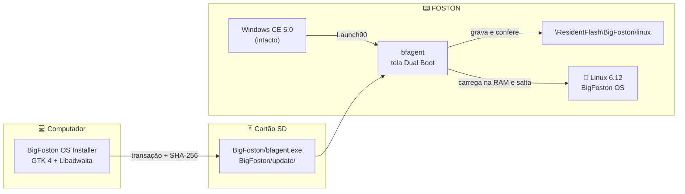

| | |
|---|---|
| **Sistema** | Linux 6.12 com drivers próprios do MT3351, Buildroot 2026.02, musl, BusyBox, BlueZ; interface própria em C com LVGL 9.2 |
| **Carregador** | o agente `bfagent` roda no Windows CE, prepara páginas físicas, zera o FCSE, desliga MMU e caches e entra no kernel (como o HaRET, que nunca suportou o MT3351) |
| **O que muda no aparelho** | a pasta `\ResidentFlash\BigFoston` (~6,2 MB, partição de dados) e `HKLM\init\Launch90`/`Depend90`; nada mais |
| **Atualização** | versão nova no cartão → o agente confere e aplica ao ligar, um arquivo por vez; se recusar, a anterior continua |
| **Segurança** | instalador sem root; imagem pública sem chave SSH; nunca grava disco do sistema nem setores brutos |

➜ [informações técnicas completas](docs/instalacao/09-informacoes-tecnicas.md) ·
[hardware](docs/01-hardware.md) · [porte do Linux](docs/04-linux-port.md) ·
[carregador](docs/05-bootloader.md) · [estado da implementação](docs/implementation-status.md)

---

## 📘 Documentação

| Instalação | Uso e recursos | Desenvolvimento |
|---|---|---|
| [Guia de instalação](docs/instalacao/README.md) | [Big GPS](docs/big-gps/00-visao-geral.md) · [Big GPS 2.0](docs/big-gps-2/00-visao-geral.md) | [Compilar do código](docs/instalacao/11-compilar-do-codigo.md) |
| [Modelos compatíveis](docs/instalacao/01-modelos-compativeis.md) | [Telefone](docs/phone/00-visao-geral.md) · [TV](docs/tv/00-visao-geral.md) · [FM](docs/fm-radio/00-visao-geral.md) | [Arquitetura do instalador](docs/installer/02-installer-architecture.md) |
| [Atualizar](docs/instalacao/06-atualizar.md) | [Foston Glass](docs/foston-glass/00-visao-geral.md) · [Grupos de apps](docs/launcher-groups-final-report.md) | [Engenharia reversa](docs/03-engenharia-reversa.md) |
| [Restaurar](docs/instalacao/05-restaurar-o-original.md) | [Bluetooth](docs/bluetooth-integration) · [Remote Play](docs/remote-play/00-overview.md) · [relay do PC](docs/remote-play/34-relay-pc.md) | [Desempenho](docs/performance/00-overview.md) · [controle em tempo real](docs/jogos-e-pacotes/07-latencia-e-modo-performance.md) |
| [Solução de problemas](docs/instalacao/07-solucao-de-problemas.md) | [Dados opcionais](docs/instalacao/10-dados-e-apps-opcionais.md) | [Dual Boot](docs/dual-boot.md) |

## 📁 Este repositório

| Pasta | Conteúdo |
|---|---|
| [`installer/`](installer) | BigFoston OS Installer (Python, GTK 4, Libadwaita), testes, pacote e `make_release.py` |
| [`src/wince/agent/`](src/wince/agent) | o agente do Windows CE: tela Dual Boot, carregador do Linux, instalação e atualização |
| [`firmware/`](firmware) | Buildroot (configurações, pacotes, patches do kernel) e `build.sh` |
| [`src/`](src) | interface (`ui`), GPS, Bluetooth, FM, TV, navegador, Remote Play, Big Screen |
| [`tools/`](tools) | `bfagent.py`, atualização pelo Linux, construtor de mapas, scripts de build |
| [`docs/`](docs) | toda a documentação, com as imagens |

## 🙏 Créditos e licença

- Projeto da comunidade [BigLinux](https://www.biglinux.com.br), sem vínculo com o fabricante FOSTON.
- [Linux](https://kernel.org), [Buildroot](https://buildroot.org), [LVGL](https://lvgl.io),
  [BlueZ](http://www.bluez.org), [NetSurf](https://www.netsurf-browser.org),
  [Moonlight](https://moonlight-stream.org), [Piper](https://github.com/rhasspy/piper),
  [CeGCC](https://cegcc.sourceforge.net); mapas © colaboradores do [OpenStreetMap](https://www.openstreetmap.org/copyright).
- Código do projeto sob a [GPL-3.0-or-later](LICENSE); drivers do kernel e frontend do NetSurf sob a
  [GPL-2.0-only](LICENSES/GPL-2.0-only.txt) ([detalhes](LICENSES/README.md)); componentes de terceiros nas licenças deles.

<div align="center">

**Dê uma vida nova ao seu GPS. É impressionante o que dá para fazer com Linux e software livre.** 💜

</div>
