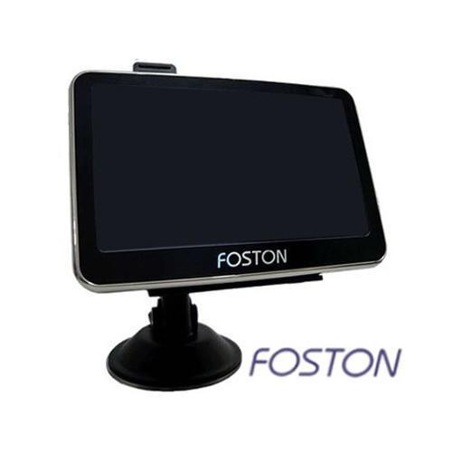

# 1 · Modelos compatíveis

[⬅ Índice](README.md) · [Próximo: preparar o computador ➡](02-preparar-o-computador.md)

## Estado por modelo

| Aparelho | Estado | O que foi conferido |
|---|:-:|---|
|  **FOSTON FS-707DC** | ✅ **Compatível e testado em hardware real** | boot, tela, toque, som, SD, USB, GPS, Bluetooth, TV, FM, bateria, Dual Boot e atualização pelo cartão; a instalação **pelo toque** (agente 0.8.0) é nova e ainda não rodou no aparelho ([ver nota](04-instalar-no-foston.md#-estado-de-teste)) |
| Outros modelos FOSTON | ❓ não testado | o instalador recusa: o pacote só aceita `foston-fs707dc` |
| Outros navegadores 7" com Windows CE e MediaTek MT3351 | ❓ não testado | o kernel, o DTB e o agente foram feitos para esta placa; endereços e pinos mudam entre fabricantes |
| Navegadores com outro processador (SiRF Atlas, Samsung S3C e outros) | ⛔ incompatível | outra arquitetura de placa: o kernel não inicia |

> ⚠️ **Só o FS-707DC foi testado, numa unidade.** Revisões vendidas com o mesmo nome podem
> ter outra placa. Por isso confira os dados abaixo antes de instalar. Se o seu aparelho
> for parecido mas diferente, [abra uma issue](https://github.com/ruscher/big-fostonos/issues/new)
> com a foto da tela “Sistema de Informação”: não tente instalar.

## Como conferir o seu aparelho

No FOSTON: **Ajustes → seta para a direita → Sistema de Informação**. O que precisa bater:

| Item | Valor da unidade testada | Como o projeto confirmou |
|---|---|---|
| Sistema | **Windows CE 5.0** (build 1400) | lido pelo agente no aparelho |
| Plataforma / OEM | `APOLLO` / `MTK` | `SystemParametersInfo` |
| Processador | **MediaTek MT3351** (ARM1176JZ-S, ARMv6, sem VFP) | registrador CP15 `main_id=0x410fb764` |
| Memória | 128 MB de RAM (o CE relata ~118 MB) | tabela de páginas do CE |
| Tela | **7" 800×480**, toque resistivo de 1 ponto | métricas do sistema |
| USB no PC | `045e:ffff` (pendrive) ou `045e:00ce` (porta serial) | `lsusb` no computador |
| Navegador de fábrica | iGO 8 | arquivos do cartão |
| Bootloader | EBoot `JWD B.13D.000000.101025.V2.0.6` | argumentos de boot em RAM |

Se você já instalou o agente, ele mesmo confirma: o instalador compara o que o agente lê
(`os`, `oem`, `platform`, `screen`) com a lista em
[`installer/bigfoston_installer/data/devices.json`](../../installer/bigfoston_installer/data/devices.json).

## Hardware do FS-707DC e o que o BigFoston OS usa

| Componente | Chip | No BigFoston OS |
|---|---|:-:|
| Processador | MediaTek MT3351, 468 MHz | ✅ kernel 6.12 próprio |
| Tela e toque | 800×480 RGB565, resistivo | ✅ |
| Som | DAC interno, alto-falante e fone | ✅ (microfone: só na voz das ligações, pelo DSP) |
| Cartão SD | controlador MSDC, FAT32 | ✅ leitura e gravação |
| USB | Mentor MUSB (só dispositivo) | ✅ rede USB, SSH, High-Speed |
| GPS | MediaTek (biblioteca MNL do aparelho) | ✅ |
| Bluetooth | MediaTek MT6611 na UART2 | ✅ música, internet do celular, Telefone, controles |
| TV digital | Siano Nova B0 ISDB-T 1seg (SPI) | ✅ |
| Transmissor FM | KT Micro KT0801A (I²C) | ✅ (não há receptor de rádio) |
| Bateria | carga por software | ✅ (carregador de tomada; o USB do PC é fraco demais) |
| Relógio (RTC) | — | ⚠️ a hora vem do Windows CE, do GPS ou da rede |

Detalhes medidos no aparelho: [hardware](../01-hardware.md) ·
[estado da implementação](../implementation-status.md).

## Cartão SD

| | |
|---|---|
| Sistema de arquivos | **FAT32** (o Windows CE do aparelho só lê FAT) |
| Tamanho | até **32 GB** (SDHC); testados: SD 2 GB e SanDisk SDHC 32 GB |
| Espaço para o sistema | ~6 MB + 4 MB de folga (os mapas do Big GPS são à parte, ver [dados opcionais](10-dados-e-apps-opcionais.md)) |
| Não use | SDXC (64 GB ou mais, exFAT), cartões com defeito de gravação |

> 💡 O cartão original do aparelho testado estava em fim de vida: lia sem erro mas falhava ao
> gravar. O instalador relê cada arquivo do cartão depois de gravar e recusa cartões assim.
