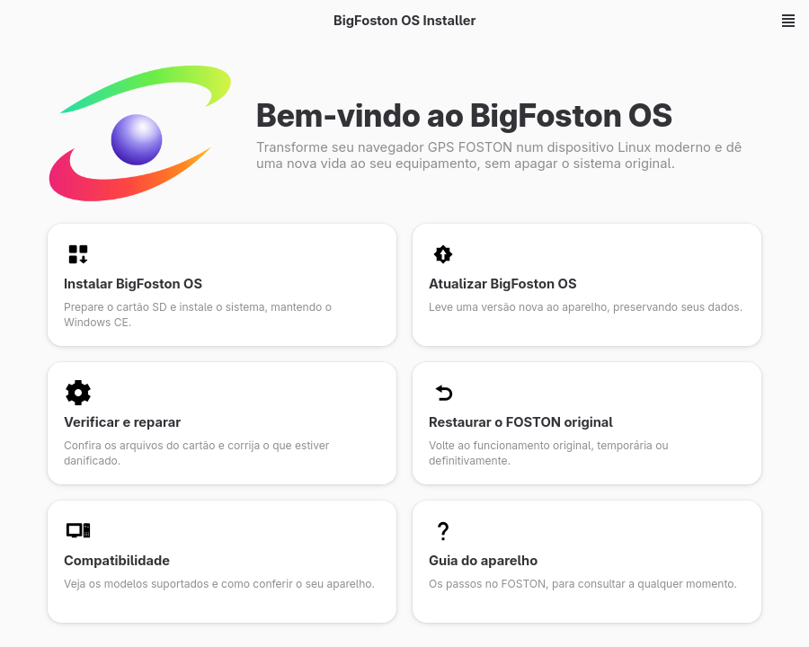

# 2 · Preparar o computador

[⬅ Modelos compatíveis](01-modelos-compativeis.md) · [Índice](README.md) · [Próximo: preparar o cartão ➡](03-preparar-o-cartao.md)

## Você vai precisar

| | | |
|:-:|---|---|
| 💻 | Computador com **Linux** | BigLinux, Manjaro, Arch, Fedora 40+, Ubuntu 24.04+, Debian 13+ (precisa de GTK 4.12+ e Libadwaita 1.5+) |
| 🃏 | **Leitor de cartões SD** | embutido no notebook ou USB; é o caminho recomendado |
| 💾 | **Cartão SD** FAT32 de até 32 GB | pode ser o próprio cartão do FOSTON (nada é apagado) |
| 🔋 | FOSTON **carregado** | ou ligado no carregador de tomada |

> 🪟 **Windows e macOS:** o instalador gráfico ainda não tem versão para eles (falta testar a
> parte de cartões). Dá para preparar o cartão à mão: veja
> [Preparar o cartão sem o instalador](03-preparar-o-cartao.md#preparar-o-cartão-sem-o-instalador).

## Passo 1 — Instalar o BigFoston OS Installer

### BigLinux, Manjaro e Arch (pacote)

```bash
git clone https://github.com/ruscher/big-fostonos.git
cd big-fostonos/installer/packaging/arch
makepkg -si
```

O pacote `bigfoston-installer` põe o atalho **BigFoston OS Installer** no menu de aplicativos
(categoria Sistema) e o comando `bigfoston-installer`. Ele depende de `python-gobject`, `gtk4`,
`libadwaita`, `udisks2` e `polkit`, que o `makepkg -s` instala.

### Qualquer distribuição (direto do código, sem instalar)

```bash
# Fedora:        sudo dnf install python3-gobject gtk4 libadwaita udisks2
# Debian/Ubuntu: sudo apt install python3-gi gir1.2-gtk-4.0 gir1.2-adw-1 udisks2
git clone https://github.com/ruscher/big-fostonos.git
big-fostonos/installer/bigfoston-installer
```

> 🔐 O instalador **roda como usuário comum**. Montar e desmontar o cartão passa pelo UDisks2;
> se o sistema pedir, o polkit mostra a janela de senha. Nada roda como root.

## Passo 2 — Baixar a versão do BigFoston OS

Na página [**Releases**](https://github.com/ruscher/big-fostonos/releases/latest), baixe
`BigFoston-OS-FS707DC-<versão>.zip` (≈ 6 MB). Ele tem:

| Arquivo | O que é |
|---|---|
| `manifest.json` | versão, data, aparelho, versão do agente e SHA-256 + tamanho de cada arquivo |
| `SHA256SUMS` | os mesmos hashes, no formato do `sha256sum` |
| `bfagent.exe` | o agente do Windows CE (abre a tela Dual Boot e grava a memória interna) |
| `linux/zImage` | o kernel Linux 6.12 |
| `linux/initrd.img` | o sistema inteiro (BusyBox, musl, interface, apps), comprimido em XZ |
| `linux/fs707dc.dtb` | a descrição do hardware para o kernel |

Para conferir o download no terminal (opcional; o instalador confere sozinho):

```bash
unzip -q BigFoston-OS-FS707DC-0.6.5.zip && cd BigFoston-OS-FS707DC-0.6.5 && sha256sum -c SHA256SUMS
```

## Passo 3 — Abrir o instalador

<p align="center"></p>

| Cartão | O que faz |
|---|---|
| **Instalar BigFoston OS** | primeira instalação: prepara o cartão e mostra os passos no FOSTON |
| **Atualizar BigFoston OS** | leva uma versão nova (o aparelho aplica sozinho ao ligar) |
| **Verificar e reparar** | relê o cartão e diz se algum arquivo foi corrompido |
| **Restaurar o FOSTON original** | como voltar ao Windows CE, por um tempo ou para sempre |
| **Compatibilidade** | os modelos suportados e como conferir o seu |
| **Guia do aparelho** | os passos no FOSTON, para consultar sem instalar nada |

➡ Continue em [Preparar o cartão SD](03-preparar-o-cartao.md).
