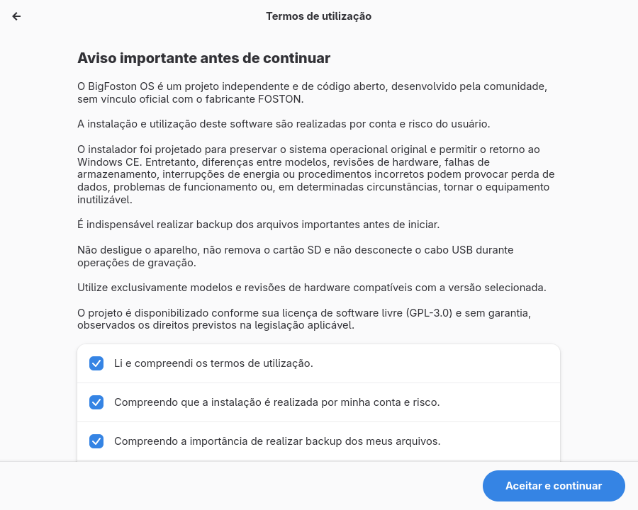
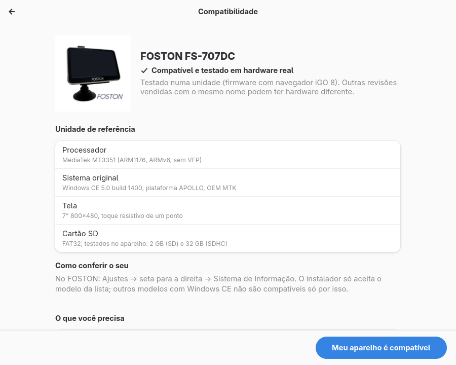
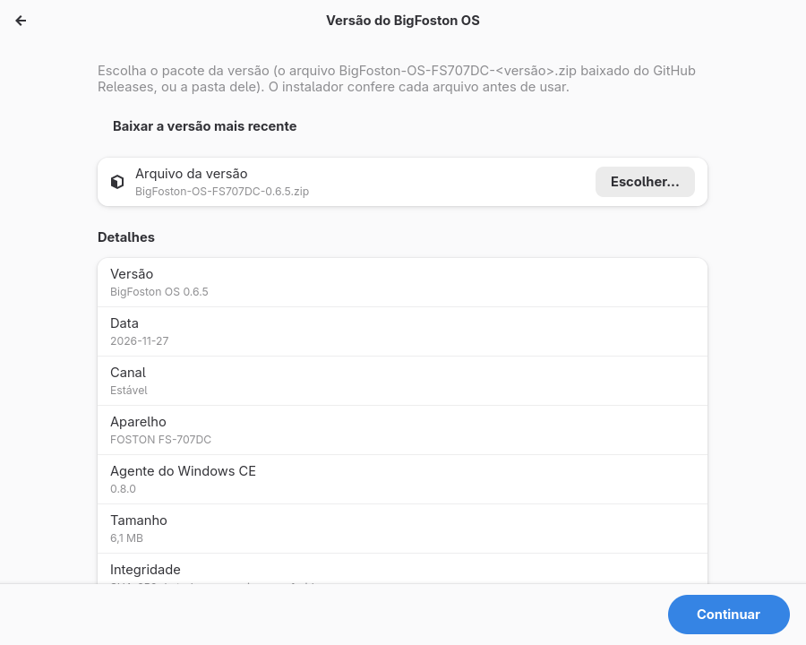
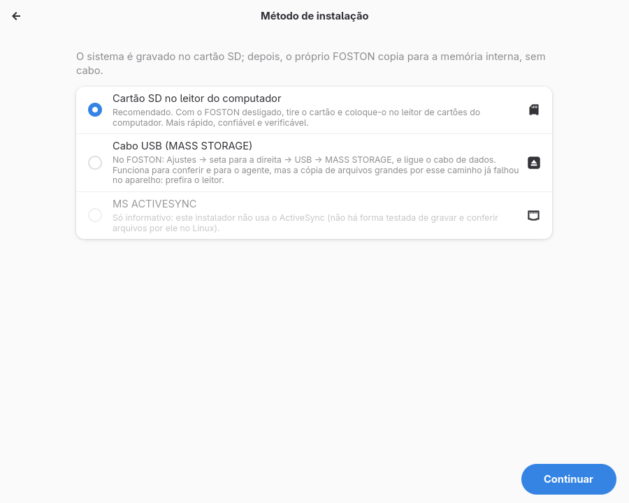
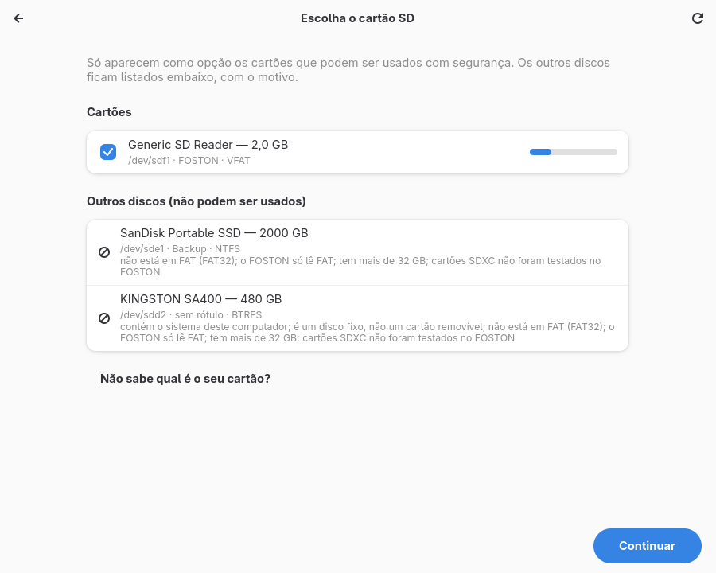
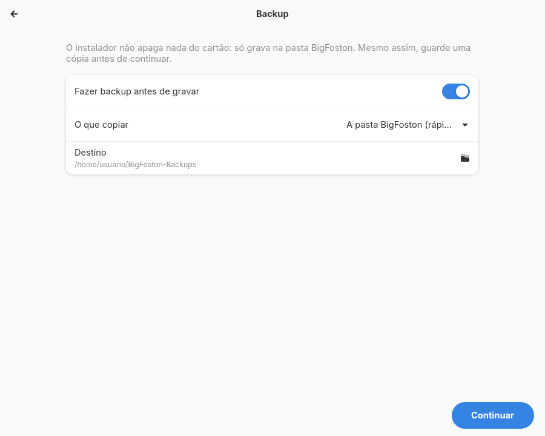
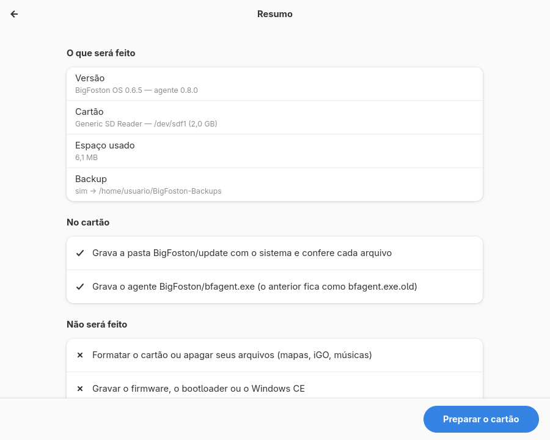
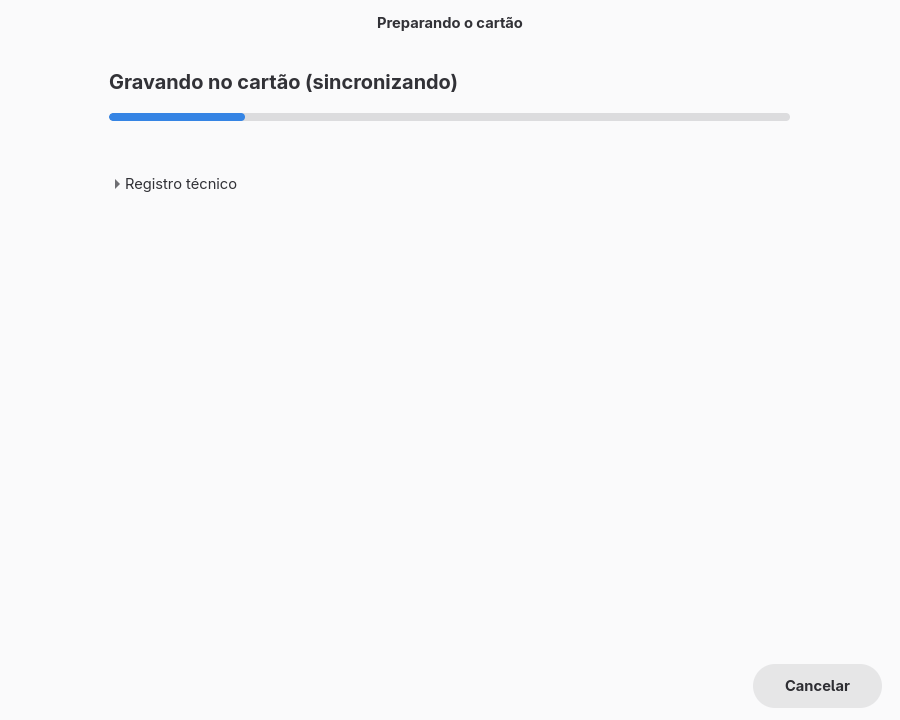
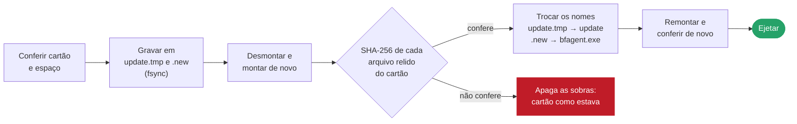

# 3 · Preparar o cartão SD

[⬅ Preparar o computador](02-preparar-o-computador.md) · [Índice](README.md) · [Próximo: instalar no FOSTON ➡](04-instalar-no-foston.md)

Com o FOSTON **desligado**, tire o cartão SD e coloque-o no leitor do computador. Abra o
BigFoston OS Installer e toque em **Instalar BigFoston OS**. São 8 telas; nenhuma grava nada
até você confirmar na última.

## 1. Termos de utilização



Leia e marque as **quatro confirmações** (o botão só acende com todas). O projeto é
independente, sem vínculo com o fabricante, e distribuído sob a GPL-3.0 sem garantia.
**Salvar os termos** guarda o texto num arquivo.

## 2. Compatibilidade



Confira se os dados batem com o seu aparelho ([como conferir](01-modelos-compativeis.md#como-conferir-o-seu-aparelho))
e toque em **Meu aparelho é compatível**.

## 3. Versão



**Escolher…** e aponte o `.zip` baixado (ou **Escolher uma pasta** com ele descompactado).
O instalador abre o pacote com uma lista fechada de nomes, confere o **SHA-256 de cada
arquivo** contra o `manifest.json` e o `SHA256SUMS`, e recusa:

- pacote de outro aparelho, com arquivo a mais ou faltando, com link simbólico ou caminho `..`;
- arquivo corrompido, adulterado ou maior do que o agente aceita;
- `.zip` que declara um tamanho e entrega outro.

## 4. Método



| Método | Quando usar |
|---|---|
| ✅ **Cartão SD no leitor do computador** | **recomendado**: rápido e verificável |
| ⚠️ Cabo USB (MASS STORAGE) | só se não houver leitor. No FOSTON: Ajustes → seta para a direita → USB → MASS STORAGE. A cópia de arquivos grandes por esse caminho já falhou no aparelho |
| ⛔ MS ACTIVESYNC | informativo: não há forma testada de gravar e conferir arquivos por ele no Linux |

## 5. Cartão



Só aparecem como opção os volumes que podem ser usados **com segurança**. Os outros ficam
embaixo, com o motivo:

| Bloqueado quando | Por quê |
|---|---|
| o disco tem `/`, `/boot`, `/home`, `/usr`, `/var`… | é o sistema do seu computador |
| é um disco fixo (não removível, não USB/SD) | não é um cartão |
| não está em FAT | o Windows CE do FOSTON só lê FAT |
| tem mais de 32 GB | SDXC/exFAT nunca foram testados no FOSTON |
| está protegido contra gravação | trava do cartão ou do leitor |

Não sabe qual é o seu? **Não sabe qual é o seu cartão?** pede para tirar e pôr o cartão: o que
aparece de novo é ele. A identidade do cartão (série do leitor, UUID do FAT e tamanho) é
conferida de novo antes de gravar e depois de cada remontagem: se você trocar de cartão no
meio, o instalador para.

## 6. Backup



O instalador **não apaga nada** do cartão (só grava a pasta `BigFoston`), mas faz uma cópia
antes, por segurança: só a pasta `BigFoston` (rápido) ou **o cartão inteiro** (mapas e tudo).
O backup vai para `~/BigFoston-Backups/BigFoston-backup-<data>-<rótulo>/`, com um
`backup.json` que guarda o SHA-256 de cada arquivo; depois de copiar, ele relê e confere tudo.

## 7. Resumo



O que **será** feito e, tão importante quanto, o que **não será**: formatar ou apagar seus
arquivos, gravar firmware/bootloader/Windows CE, ou mudar o aparelho agora. **Preparar o
cartão** pede uma última confirmação.

## 8. Gravação e conferência



A gravação é uma **transação**:



- O progresso mostrado são **bytes de verdade**, com velocidade e tempo restante; o
  **Registro técnico** mostra cada etapa.
- **Cancelar** funciona até a troca de nomes; uma falha antes dela deixa o cartão como estava.
- A releitura vem do cartão, não do cache do computador: um cartão que corrompe ao gravar é
  pego aqui.

Ao terminar, o cartão é **ejetado** e o instalador mostra o [guia do aparelho](04-instalar-no-foston.md).

## O que fica no cartão

```
BigFoston/
├── bfagent.exe            o agente (você aponta o “Caminho da navegação” para ele)
├── bfagent.exe.sha256
├── bfagent.exe.old        o agente anterior, se havia
├── install.json           versão preparada (lida pelo instalador em “Verificar e reparar”)
└── update/                o FOSTON grava isto na memória interna e renomeia para update.ok
    ├── zImage
    ├── initrd.img
    ├── fs707dc.dtb
    └── SHA256SUMS         gravado por último
```

Nada fora de `BigFoston/` é tocado: mapas, iGO, músicas e a pasta `BigFoston/data` (ajustes
do BigFoston OS) continuam lá.

## Preparar o cartão sem o instalador

Para Windows, macOS ou para quem prefere o terminal. Com o cartão montado em `$CARTAO`:

```bash
P=BigFoston-OS-FS707DC-0.6.5            # pasta do .zip descompactado
cd "$P" && sha256sum -c SHA256SUMS      # 1. confira o pacote
mkdir -p "$CARTAO/BigFoston/update"
cp bfagent.exe "$CARTAO/BigFoston/"
cp linux/zImage linux/initrd.img linux/fs707dc.dtb "$CARTAO/BigFoston/update/"
# 2. o SHA256SUMS do update vai por último e sem o prefixo linux/ (é o que o agente lê)
(cd linux && sha256sum zImage initrd.img fs707dc.dtb) > "$CARTAO/BigFoston/update/SHA256SUMS"
sync && umount "$CARTAO"
```

> ⚠️ Use sempre o `fs707dc.dtb` **do pacote**: ele já tem o campo
> `/chosen/bigfoston,boot-epoch` que o agente exige. Um DTB tirado direto do build é
> **recusado** na partida (`update.log`: “RECUSADA: fs707dc.dtb sem /chosen/bigfoston,boot-epoch”).
