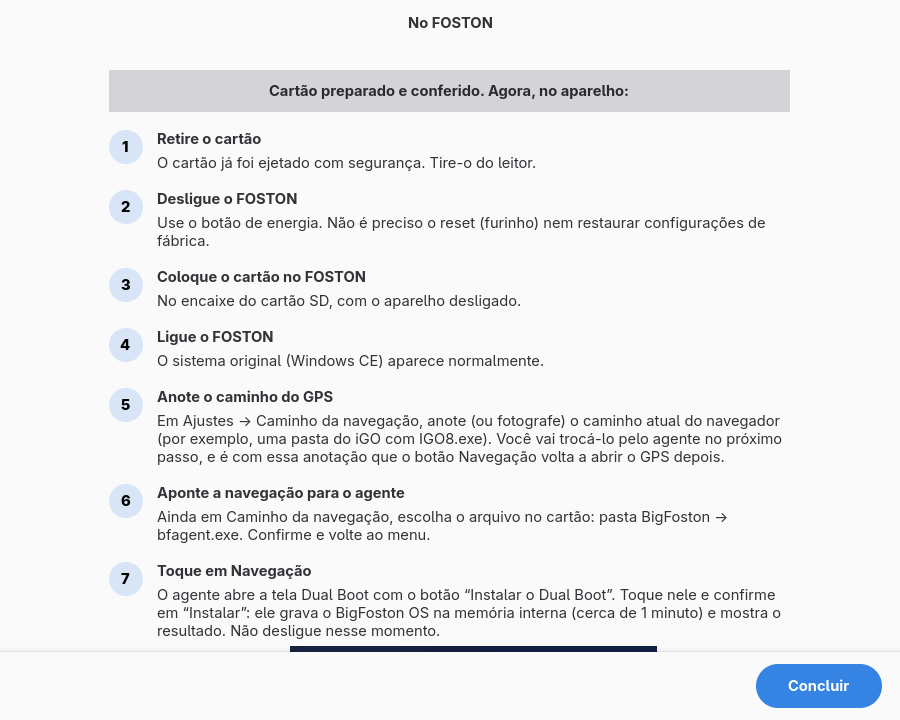
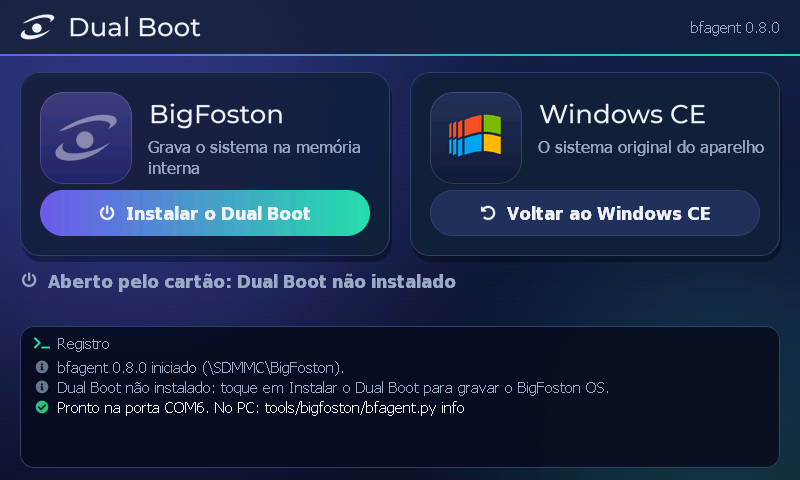
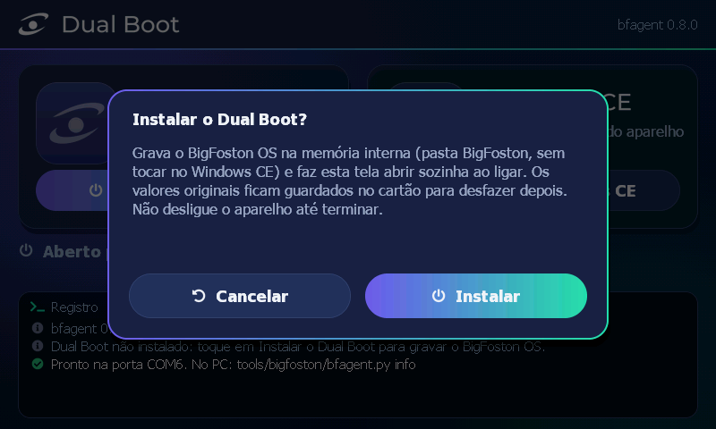
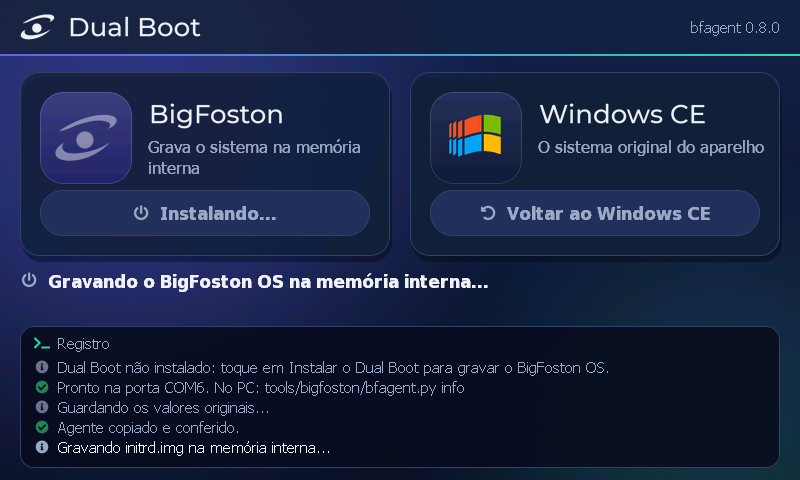
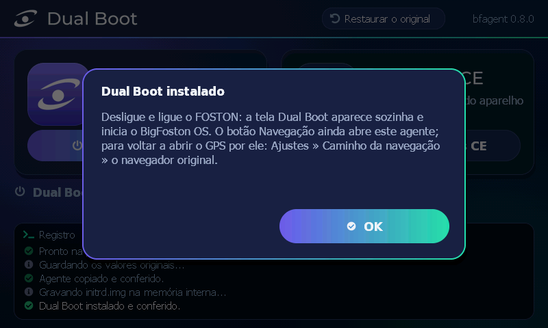
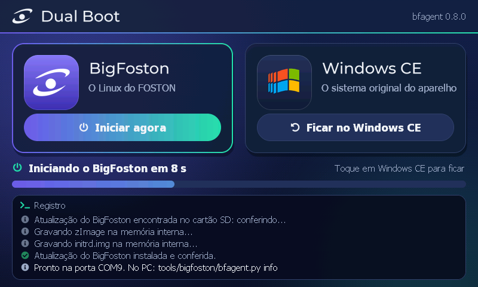
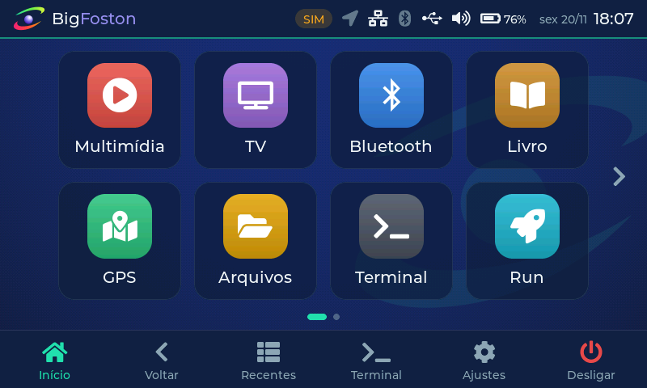
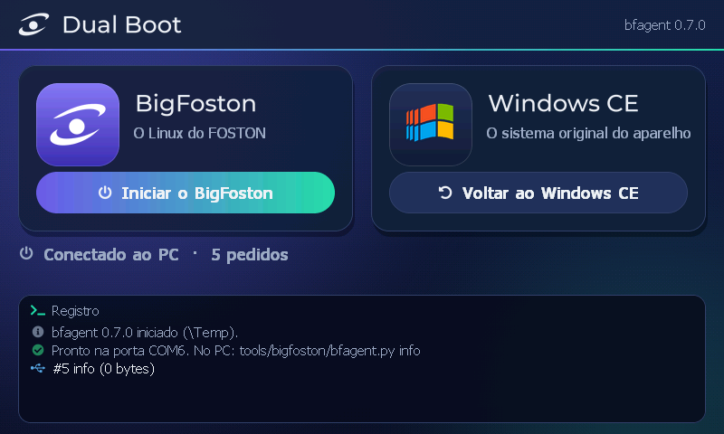

# 4 · Instalar no FOSTON (Dual Boot)

[⬅ Preparar o cartão](03-preparar-o-cartao.md) · [Índice](README.md) · [Próximo: restaurar o original ➡](05-restaurar-o-original.md)

O cartão está pronto. Agora é o **próprio FOSTON** que grava o BigFoston OS na memória
interna, pelo sistema de arquivos do Windows CE dele. Sem cabo, sem terminal.

## Passo a passo

| # | No FOSTON | Detalhe |
|:-:|---|---|
| 1 | **Desligue** o FOSTON pelo botão de energia | não precisa do reset (furinho) nem de restaurar configurações de fábrica |
| 2 | **Coloque o cartão** no encaixe SD | com o aparelho desligado |
| 3 | **Ligue** | o Windows CE abre normalmente, com o menu do GPS |
| 4 | **Anote o caminho do GPS** | em **Ajustes → Caminho da navegação**, anote ou fotografe o caminho atual (por exemplo, uma pasta do iGO com `IGO8.exe`). É com ele que o botão Navegação volta a abrir o GPS depois |
| 5 | **Aponte para o agente** | ainda em Caminho da navegação, escolha no cartão: pasta **BigFoston → bfagent.exe**, confirme e volte ao menu |
| 6 | **Toque em Navegação** | abre a tela **Dual Boot** do agente, com o botão **Instalar o Dual Boot** |
| 7 | **Instalar o Dual Boot → Instalar** | grava a memória interna (cerca de 1 minuto). **Não desligue** nesse momento |
| 8 | **Dual Boot instalado → OK** | tudo gravado e conferido por SHA-256 |
| 9 | **Desligue e ligue** | aparece a tela Dual Boot com a contagem de 12 s e o BigFoston OS inicia sozinho |

### As telas do agente

| 6 · Aberto pelo cartão | 7 · Confirmação |
|:-:|:-:|
|  |  |
| **7 · Instalando** | **8 · Instalado** |
|  |  |
| **9 · Ao ligar: contagem** | **Pronto: BigFoston OS** |
|  |  |

As telas do agente são desenhadas no PC pelo mesmo código que roda no aparelho
(`src/wince/agent/ui.c`, `make preview`); a foto abaixo é a mesma tela capturada do FOSTON real.

## O que o “Instalar o Dual Boot” faz, em ordem

1. **Guarda os valores originais** em `BigFoston\recuperacao\original.txt` no cartão (e uma
   cópia na memória interna), uma vez só: `HKLM\init\Launch90`, `Depend90`, o caminho da
   navegação e o modo USB.
2. **Copia o agente** para `\ResidentFlash\BigFoston\bfagent.exe` e confere o SHA-256.
3. **Grava o Linux** de `BigFoston\update` em `\ResidentFlash\BigFoston\linux`, arquivo por
   arquivo, conferindo cada um; o `SHA256SUMS` vai por último (sem ele o boot automático não
   inicia um conjunto pela metade). O resultado fica em `BigFoston\update.log` (APLICADA ou
   RECUSADA) e a pasta vira `update.ok`.
4. **Liga o início automático**: `autoboot.conf` (`delay=12`) e
   `HKLM\init\Launch90 = \ResidentFlash\BigFoston\bfagent.exe`, `Depend90 = 14 00 32 00`
   (abre depois do `device.exe` e do menu).
5. **Confere tudo** relendo o registro e os arquivos. Se algo falhar, a tela diz o quê, e
   **nada do Windows CE foi alterado**: toque em **Restaurar o original** para desfazer.

## Usando o Dual Boot no dia a dia

| Você quer | Faça |
|---|---|
| BigFoston OS | só ligue e espere 12 s (ou toque em **Iniciar agora**) |
| Windows CE (GPS original) | toque em **Ficar no Windows CE** durante a contagem |
| Sair do BigFoston OS para o CE | **reset** (furinho com um clipe) ou desligue e ligue e toque em Windows CE |
| Desligar | no BigFoston OS: botão de energia → **Desligar** |

O botão **Navegação** do menu do CE continua abrindo o agente. Para ele voltar a abrir o
GPS: **Ajustes → Caminho da navegação → o caminho que você anotou no passo 4**.

## 🧪 Estado de teste

| Parte | Estado |
|---|---|
| Preparação do cartão pelo instalador | ✅ 35 testes automáticos (núcleo, cartão que corrompe, cancelamento, interface inteira num display virtual); os 2 de integração com o UDisks2 real (disco FAT32 de loop) pedem a senha do polkit e passaram em 25/11/2026 |
| Gravar a memória interna a partir do cartão (`apply_sd_update`) | ✅ o mesmo código das atualizações desde o agente 0.6.0 (0.5.0, 0.5.1 e as 0.6.x aplicadas assim no aparelho) |
| Início automático (`Launch90`/`Depend90`, `autoboot.conf`) e tela Dual Boot | ✅ em uso diário desde o agente 0.7.0 |
| **O botão “Instalar o Dual Boot” (agente 0.8.0) como um todo** | ⚠️ **novo: ainda não rodou no aparelho**. Ele junta as peças acima, que já funcionam, mas a sequência completa pelo toque não foi executada no FOSTON real |

Se a instalação pelo toque não terminar, a tela mostra o motivo e o registro; o Windows CE
segue intacto. O caminho já validado no aparelho é a
[instalação avançada pelo cabo USB](08-instalacao-avancada-usb.md). Relatos são muito bem-vindos
em [issues](https://github.com/ruscher/big-fostonos/issues/new) (com a foto da tela e o
`BigFoston\update.log` do cartão).
