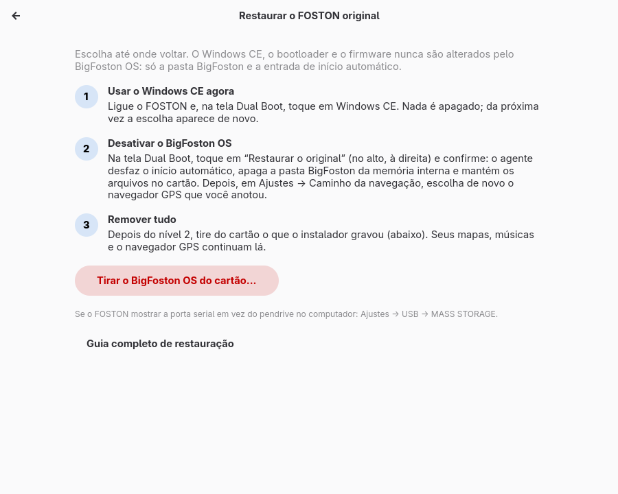
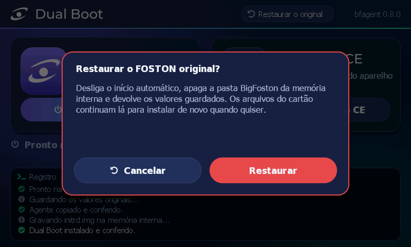

# 5 · Restaurar o FOSTON original

[⬅ Instalar no FOSTON](04-instalar-no-foston.md) · [Índice](README.md) · [Próximo: atualizar ➡](06-atualizar.md)

O Windows CE, o bootloader (EBoot) e as partições do sistema **nunca são alterados** pelo
BigFoston OS. O que muda no aparelho é pouco e reversível: a pasta
`\ResidentFlash\BigFoston` na partição de dados da memória interna e a entrada de início
automático `HKLM\init\Launch90`/`Depend90` no registro.

<p align="center"></p>

## Três níveis

| Nível | Para quê | Como |
|:-:|---|---|
| **1** | usar o Windows CE **agora** | ligue e toque em **Ficar no Windows CE** na contagem. Nada é apagado |
| **2** | **desativar** o BigFoston OS | na tela Dual Boot, toque em **Restaurar o original** (no alto, à direita) e confirme |
| **3** | **remover tudo** | depois do nível 2, tire do cartão o que o instalador gravou |

### Nível 2 no aparelho



O agente:

1. devolve `Launch90`/`Depend90` aos valores guardados na instalação (ou os apaga, se não
   existiam);
2. apaga **só** a pasta `\ResidentFlash\BigFoston` (agente, Linux, `autoboot.conf`);
3. volta o USB a abrir como armazenamento (MASS STORAGE), se tinha ficado como porta serial;
4. se o caminho da navegação guardado for o do GPS, devolve-o. Na instalação normal ele já
   apontava para o agente quando foi guardado, então **escolha você o GPS de novo**:
   **Ajustes → Caminho da navegação → o caminho anotado** (no aparelho testado,
   `7 pole 2012\IGO8.exe` no cartão).

Os arquivos do cartão ficam, para reinstalar quando quiser.

> 💡 Se o agente não abre (cartão trocado, por exemplo), o mesmo resultado sai pelo
> [caminho avançado](08-instalacao-avancada-usb.md#desfazer-pelo-cabo-usb):
> `bfagent.py autostart off` e `bfagent.py rm '\ResidentFlash\BigFoston\bfagent.exe'`.

### Nível 3 no computador

No instalador: **Restaurar o FOSTON original → Tirar o BigFoston OS do cartão…**. Ele remove
do cartão **só** o que gravou: `bfagent.exe` (e `.sha256`, `.old`, `.new`), `install.json`,
`update/` e `update.tmp/`. Ficam: seus arquivos, a pasta `BigFoston/data` (ajustes do
BigFoston OS), `recuperacao/` e os registros. À mão:

```bash
rm -rf "$CARTAO"/BigFoston/{bfagent.exe*,install.json,update,update.tmp}
```

## Situações de recuperação

| Situação | O que fazer |
|---|---|
| Linux com a tela parada ou com faixas | **reset** (furinho com um clipe, ou segure o botão de energia ~10 s): volta ao Windows CE |
| Navegação abre o agente em vez do GPS | Ajustes → Caminho da navegação → o navegador original |
| O PC vê porta serial (`045e:00ce`) em vez de pendrive | no FOSTON: Ajustes → USB → MASS STORAGE |
| `reboot -f` no Terminal **desligou** o aparelho | é o watchdog do hardware (o CE faz igual): ligue pelo botão |
| Versão nova não funciona | copie a versão anterior para `BigFoston/update` (o instalador faz isso com o `.zip` anterior em **Atualizar**) e desligue e ligue |
| Cartão corrompido | o Windows CE não depende dele; restaure o backup do instalador (`~/BigFoston-Backups/…/files/`) |

Guia técnico completo de recuperação: [17-recuperacao.md](../17-recuperacao.md).
