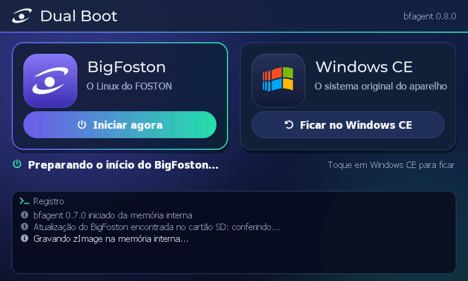
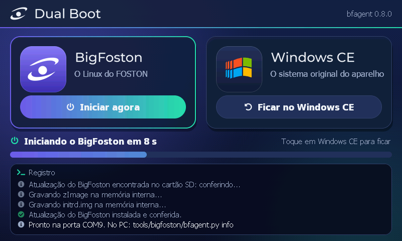

# 6 · Atualizar o BigFoston OS

[⬅ Restaurar o original](05-restaurar-o-original.md) · [Índice](README.md) · [Próximo: solução de problemas ➡](07-solucao-de-problemas.md)

Com o Dual Boot instalado, atualizar é só pôr a versão nova no cartão: **o agente aplica
sozinho ao ligar**, antes da contagem.

## Pelo instalador (recomendado)

1. Baixe o `.zip` novo em [Releases](https://github.com/ruscher/big-fostonos/releases/latest).
2. FOSTON desligado → cartão no leitor → **Atualizar BigFoston OS**.
3. Escolha o pacote, o cartão e o backup; **Preparar o cartão**.
4. Cartão de volta no FOSTON (desligado) → **ligue**.

| Ao ligar | Depois |
|:-:|:-:|
|  |  |
| “Preparando o início do BigFoston…”: **não desligue** | a contagem e o BigFoston OS novo |

Confira a versão no BigFoston OS em **Ajustes → Sistema**. O resultado fica no cartão em
`BigFoston/update.log`:

```
APLICADA: zImage 2114336, initrd.img 3899356, fs707dc.dtb 3324 bytes; zImage 90c729db22a558b8
```

## Como o agente aplica (e por que é seguro)

- Confere o SHA-256 de cada arquivo do cartão contra o `SHA256SUMS`; o DTB precisa ter o
  campo `bigfoston,boot-epoch`. Qualquer diferença: **RECUSADA**, a pasta vira `update.bad` e
  **o Linux instalado continua funcionando**.
- A memória interna (`\ResidentFlash`, 12 MB) não comporta duas versões inteiras: o agente
  grava **um arquivo por vez**, conferindo cada um, e apaga o `SHA256SUMS` instalado antes de
  começar. Se faltar energia no meio, o próximo boot **continua de onde parou** (o conjunto
  incompleto nunca é iniciado).
- Aplicada, a pasta vira `update.ok` (nunca é aplicada duas vezes).

## Pelo próprio BigFoston OS (desenvolvedores)

Com o FOSTON ligado no Linux e a rede USB ativa (`192.168.7.2`):

```bash
tools/bigfoston/linux-update.py stage     # grava BigFoston/update no cartão por SSH e confere
```

Depois **desligue e ligue**: é o Windows CE que aplica (com uma atualização pendente, o Reiniciar do BigFoston OS avisa e pede isso).
