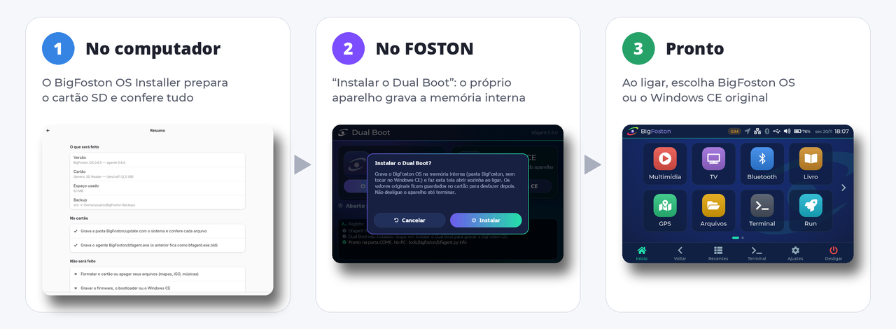
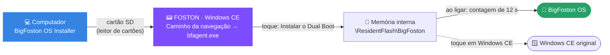

# 📘 Guia de instalação do BigFoston OS

Este guia leva você do aparelho de fábrica até o BigFoston OS rodando, e de volta ao original
se quiser. Cada passo foi conferido com o aparelho real e com o instalador em funcionamento;
as imagens são capturas de verdade (do instalador, da tela do agente no Windows CE e do
BigFoston OS).

| # | Página | Para quê | Tempo |
|:-:|---|---|:-:|
| 1 | [Modelos compatíveis](01-modelos-compativeis.md) | conferir se o seu aparelho é o certo | 2 min |
| 2 | [Preparar o computador](02-preparar-o-computador.md) | instalar o BigFoston OS Installer e baixar a versão | 5 min |
| 3 | [Preparar o cartão SD](03-preparar-o-cartao.md) | o instalador grava e confere o sistema no cartão | 3 min |
| 4 | [Instalar no FOSTON](04-instalar-no-foston.md) | o próprio aparelho grava a memória interna (Dual Boot) | 5 min |
| 5 | [Restaurar o original](05-restaurar-o-original.md) | voltar ao Windows CE, por um tempo ou para sempre | 2 min |
| 6 | [Atualizar](06-atualizar.md) | levar uma versão nova ao aparelho | 3 min |
| 7 | [Solução de problemas](07-solucao-de-problemas.md) | sintomas, causas e o que fazer | — |
| 8 | [Instalação avançada pelo cabo USB](08-instalacao-avancada-usb.md) | o caminho de linha de comando, para quem desenvolve | 15 min |
| 9 | [Informações técnicas](09-informacoes-tecnicas.md) | o que muda no aparelho, a cadeia de boot, os arquivos | — |
| 10 | [Dados e apps opcionais](10-dados-e-apps-opcionais.md) | mapas do Big GPS, voz, TV, Internet, Remote Play | — |
| 11 | [Compilar do código](11-compilar-do-codigo.md) | gerar o sistema, o agente e o pacote do zero | 1–2 h |

## Em uma frase

> O instalador do computador **só prepara o cartão SD**; quem grava a memória interna é o
> **próprio FOSTON**, pelo Windows CE dele, quando você toca em **“Instalar o Dual Boot”**.
> Nada do Windows CE, do bootloader ou do firmware é alterado, e tudo pode ser desfeito.

## Antes de começar: 4 regras que evitam problemas

1. **Bateria carregada ou carregador de tomada ligado.** O aparelho não pode desligar
   enquanto grava a memória interna.
2. **Use um leitor de cartões no computador.** Pelo cabo USB do FOSTON a cópia de arquivos
   grandes não é confiável (o Windows CE perde dados e guarda cópias antigas em cache).
3. **Anote o “Caminho da navegação” original** (Ajustes do FOSTON) antes de trocá-lo: é com
   ele que o botão Navegação volta a abrir o GPS.
4. **Não formate o cartão** se ele tem os mapas do GPS original: o instalador não apaga nada,
   só grava a pasta `BigFoston`.
