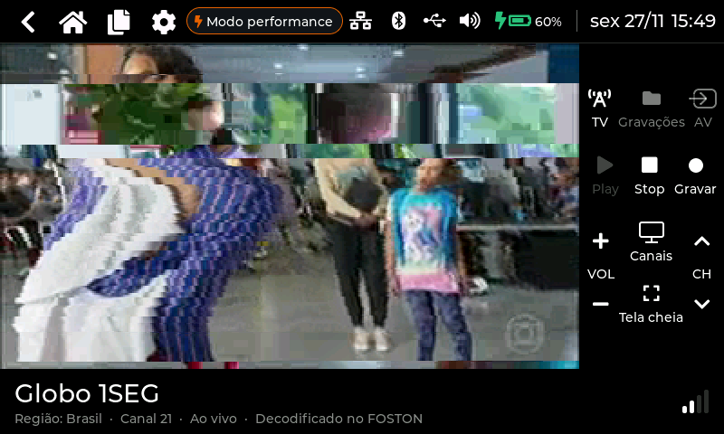

# Etapa 3 — TV sem o cabo USB: causa raiz e fluidez

Queixa: "a TV continua travando, principalmente sem o cabo USB ligado ao computador".

A investigação mediu o aparelho em três situações:
- com o PC no cabo;
- sem o PC (relay parado, como no carro);
- trocando entre os dois com a TV tocando.

"Travar" tinha quatro causas diferentes, e só uma era o decodificador.

## Causa 1 — o PC não voltava mais (e a TV ficava no ARM)

**O que se via:** com o cabo USB ligado e o relay ativo no PC, a TV decodificava no FOSTON:
`relay=0`, 4 qps no SBT, degrau 2 da escada.

**Causa raiz:** no PC, o `bftv-relay` estava em `ESTAB` com 192.168.7.2:48122 havia 9 h, com
51 ms de CPU no total. O FOSTON tinha reiniciado. Sem keepalive e sem prazo, a thread de leitura
esperava num `read()` de uma conexão que não existia mais. O laço de reconexão nunca rodava de
novo. O mesmo acontece arrancando o cabo no meio da TV.

**Correção** (`src/tv/bftv-relay.c`, `connect_to`):
- `SO_KEEPALIVE` com `TCP_KEEPIDLE` 3 s, `TCP_KEEPINTVL` 1 s e `TCP_KEEPCNT` 3;
- `TCP_USER_TIMEOUT` de 6 s.

Um FOSTON novo responde RST ao primeiro teste; um cabo fora estoura em ~6 s. A leitura volta com
erro, a sessão fecha e o relay volta a tentar a cada 1 s.

**Teste no aparelho** (cabo "arrancado" derrubando a `usb0` do FOSTON por 15 s com a TV
tocando pelo PC):

| Tempo | PC (conexões em :48122) | FOSTON |
|---|---|---|
| 0 s | 1 | `relay=1` |
| +12 s | 0 (sessão morta descartada) | decodifica aqui |
| +15 s | 1 (reconectou) | `relay=1`, 24 qps, 0 cortes de som |

Para quem já tem o relay instalado: `tools/bigfoston/tv-relay-install.sh` recompila e reinicia o
serviço.

## Causa 2 — a interface parava o laço

O `bftvd` é filho do shell. Três lugares esperavam por ele **na thread da interface**:

| Onde | Antes | Medido |
|---|---|---|
| Sair da TV | `SIGTERM` e espera até 2 s; depois `bftvd -O` com `waitpid` sem prazo | `bftvd` sai em 0,63 s; `-O` leva 0,09 s; laço parado **1026 / 1082 ms** |
| Buscar canais | `usleep` até o vídeo parar (até 2 s) | — |
| Trocar de canal | já era assíncrono | — |

**Correção** (`src/ui/screens/scr_tv.c`): o ciclo do player virou uma máquina de estados que vive
além da tela, conferida por um timer de 100 ms:

```
tocando ──SIGTERM──► encerrando ──saiu (ou SIGKILL em 3 s)──► desligando (-O, SIGKILL em 3 s) ──► livre
```

- Sair da TV entrega o processo a essa máquina e a interface segue na hora.
- Abrir a TV, trocar de canal ou buscar com o anterior ainda saindo só marca o pedido
  (`want_start` ou `want_scan`); o tique começa quando o sintonizador estiver livre. Nunca há dois
  `bftvd` no sintonizador (o `-O` desligando e o novo ligando juntos).

| Medido no aparelho (pior volta do laço) | Antes | Depois |
|---|---|---|
| Sair da TV (2 rodadas) | 1026 / 1082 ms | **476 / 564 ms** (o resto é montar a Início com o papel de parede) |
| Começar uma busca com o vídeo tocando | até 2 s | **77 ms** |
| 6 trocas de canal em 4,2 s | — | 224 ms, nunca mais de um `bftvd` |

Cancelar a busca mantém a lista: o `bftvd -S` só troca o `canais.tsv` no fim e apaga o `.tmp`
se for interrompido. Conferido com `cmp` contra a cópia de antes.

## Causa 3 — a interface competia com o vídeo

`perfstat trace` com a TV tocando mostrou áreas redesenhadas sem nada mudar:
- os ícones da barra de cima, cada um 4 vezes por segundo;
- os três botões de fonte e o ponto de gravar, 2 vezes por segundo;
- a barra do sinal.

Três origens:
1. **LVGL 9.2:** `lv_obj_remove_flag(HIDDEN)` num objeto já visível invalida o objeto e suja o
   layout do pai. A barra de cima faz isso a cada segundo, em toda tela. Correção no patch
   `src/ui/patches/0006-lvgl-flags-no-op-when-unchanged.patch`: `add_flag`/`remove_flag` sem
   efeito quando os flags não mudam.
2. **Barra de cima:** `icon_state` reaplicava cor e opacidade de cada ícone a cada segundo.
   Agora usa `bf_text_color_if`/`bf_text_opa_if` (`core/theme.h`), que só mexem quando muda.
3. **TV:** a opacidade dos botões de fonte e a cor do ponto de gravar seguem o mesmo princípio.

**Medido no aparelho, A/B com o binário antigo**, TV tocando pelo PC no mesmo canal, 20 s cada,
duas rodadas:

| Interface durante a TV | Antigo | Novo |
|---|---|---|
| Quadros redesenhados | 60 / 60 (3,0 por s) | **7 / 8** (0,3–0,4 por s) |
| Tempo de desenho no período | ~660 ms | ~40 ms |
| Laço (média / p95) | 3,8 / 24 ms | **0,8 / 2 ms** |

Isso vale para todas as telas, não só a TV (a barra de cima é a mesma).

## Causa 4 — o processador (sem o PC)

Sem o PC, o ARM11 sem FPU decodifica o que consegue. A escada de decodificação e o áudio em
thread própria já existiam ([../tv/08-relay-pc.md](../tv/08-relay-pc.md),
[../energia-e-desempenho/03-tv-fluidez.md](../energia-e-desempenho/03-tv-fluidez.md)).

O modo TV tira o resto do caminho:
- GPS (9,9 % parado) e tarefas pausados;
- relatório periódico parado (1,5 %);
- interface quase sem redesenhar;
- `bftvd` protegido do OOM (−1000) e reforçado em nice −10 a cada 5 s (trocar de canal é um
  processo novo).

| Globo sem o PC, pelo app TV, 20 s | Medido |
|---|---|
| Quadros na tela | 13–15 qps (a doc anterior registrava 11–13) |
| Som | 0 cortes |
| TS | 0 perdido, 0 transbordos do anel |
| CPU | `bftvd` 83 %, shell 2 % |

O SBT (H.264 Main com quadros B a 30 qps) continua no degrau 2 (~4–5 qps limpos), o limite do
ARM11 com som contínuo. Com o PC no cabo, 30 qps; a causa 1 garante que o PC volta.

### Sem o cabo: não esperar quem não vem

Ao abrir ou trocar de canal, o `bftvd` esperava até 1,5 s pelo PC. Agora ele olha
`/sys/class/udc/*/state`: só um PC que enumerou o gadget USB deixa `configured`. Sem PC, a
espera é zero. A thread de leitura continua aceitando o PC a cada 0,5 s, então um cabo ligado
depois assume na hora.

## Vigia contra o player travado

Tocando, o `bftvd` regrava `/run/bigfoston-tv` a cada 1 s. Se o arquivo não muda há 10 s com o
processo vivo e o estado em `tocando`, o player travou (SPI, `/dev/dsp` ou framebuffer). Ele é
encerrado em segundo plano e um novo começa.

- **Limite:** no máximo 3 vezes a cada 2 min, para não entrar em laço com um defeito que não
  passa.
- **Relógio:** o prazo conta no relógio monotônico desde a última mudança do arquivo; o relógio
  de parede pode pular (NTP, GPS).

## Trocas a quente (testado)

| Situação | Resultado |
|---|---|
| TV sem o PC, liga o relay | `relay=1` em ≤ 6 s, 0 cortes de som, 0 drops |
| TV pelo PC, para o relay | volta ao FOSTON em ≤ 4 s, 0 cortes |
| PC de novo | `relay=1` em ≤ 6 s |
| Cabo "arrancado" 15 s (rede USB fora) | os dois lados se recuperam sozinhos (tabela da causa 1) |
| Tela cheia com o modo e a etiqueta | fica em tela cheia (a etiqueta não conta como "algo por cima") |

## Na tela

O rodapé da TV diz quem decodifica:
- **"Decodificado no PC"**: pelo cabo USB, 30 qps;
- **"Decodificado no FOSTON"**: no carro, sem o PC.



(A imagem com blocos é da recepção da antena no momento da captura, não do player: TS perdido 0.)
