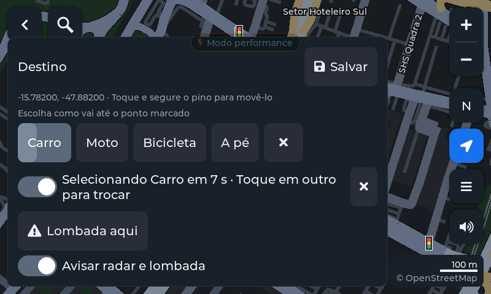
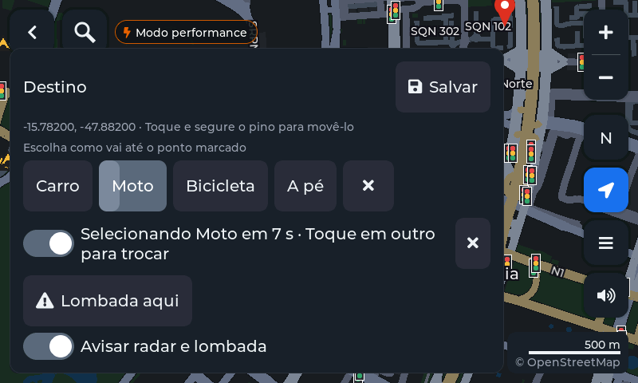
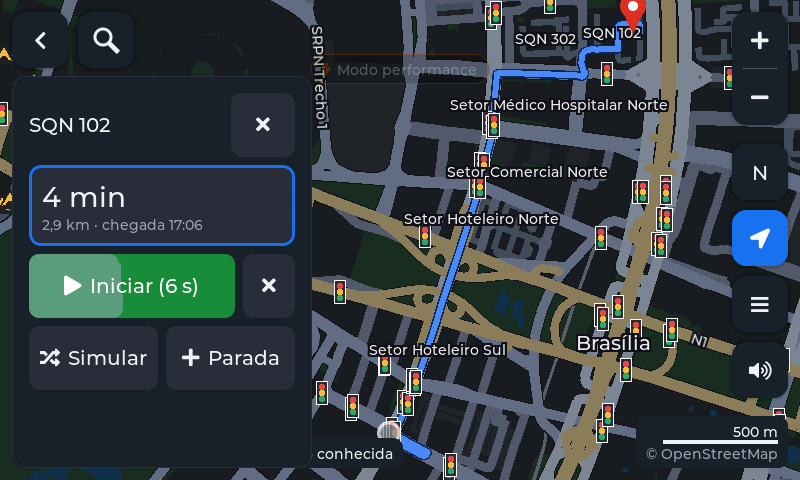
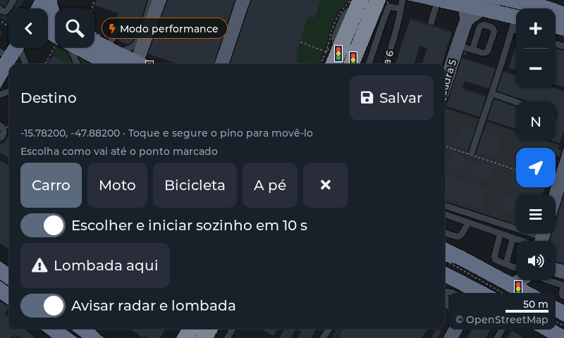
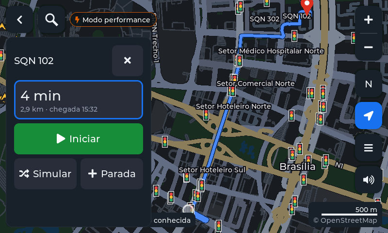
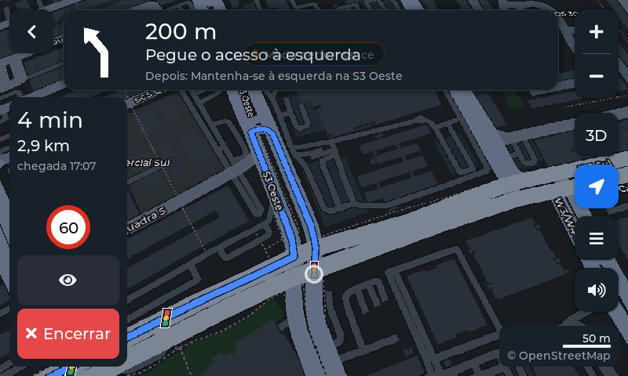

# Etapa 4 — Big GPS: o transporte lembrado e as contagens de 10 s

Objetivo: do destino escolhido até a navegação, sem precisar tocar em nada, mas com a mão no
controle a qualquer momento.

## O fluxo

```
destino marcado (busca, favorito, toque longo no mapa)
   │
   ▼
AG_VEH  o último transporte aceso; "Selecionando Carro em 10 s · Toque em outro para trocar"
   │      toque noutro transporte ──► escolhe já e ele vira o lembrado
   │      10 s sem toque          ──► escolhe o lembrado
   │      toque em outra coisa do painel ou no ✕ ──► para (só desta vez)
   ▼
rota calculada (0,8 s medido no aparelho, mais as alternativas em segundo plano)
   │
   ▼
AG_GO   "Iniciar (10 s)" se preenchendo
          toque em Iniciar        ──► navega já
          10 s sem toque          ──► navega
          toque em outra coisa do painel (alternativa, parada, simular) ou no ✕ ──► para
```

| Destino com contagem | Lembrou a Moto | Iniciar com contagem |
|---|---|---|
|  |  |  |

| Parou no ✕ (destino) | Parou no ✕ (Iniciar) | Navegando |
|---|---|---|
|  |  |  |

(Capturas do FOSTON, mapa do Brasil, posição de teste na Esplanada pelo `mapdemo 18`. As três de
baixo, menos "Navegando", são da primeira versão da etiqueta (no canto); as contagens são as mesmas.)

## Memória do transporte

- `map_last_prof` em `settings.conf` (0 carro, 1 moto, 2 bicicleta, 3 a pé).
- É gravado quando a escolha muda, venha ela do toque ou da contagem (`profile_go`).
- Se o perfil lembrado não tem dados de rota no cartão, acende o primeiro que tiver.
- O painel do destino acende o lembrado em vez de sempre o Carro.

## Máquina de estados

O estado da contagem vive fora do painel (`ag` em `scr_map.c`):

| Campo | Papel |
|---|---|
| `phase` | `AG_NONE`, `AG_VEH` ou `AG_GO` |
| `t0` | começo, em `lv_tick` (monotônico) |
| `veh_declined`, `go_declined` | o usuário parou neste destino / nesta rota |
| `btn`, `fill`, `lbl`, `stop` | o painel atual (ligados por `ag_bind`, soltos por `ag_detach`) |

Por que fora do painel:
- As **rotas alternativas** chegam segundos depois e **refazem** o painel. A contagem continua de
  onde estava (`ag_bind` só reinicia `t0` quando a fase muda).
- **Fechar o painel de vez** (cancelar, novo destino, sair do mapa) solta os ponteiros; o tique
  vê o botão sumido e encerra. Nenhum ponteiro para objeto apagado sobra.
- Um **timer de 100 ms** pinta o preenchimento e troca o texto só quando o número muda. Não usa
  `lv_anim`, então funciona com as animações desligadas (modo GPS) e custa só a área do botão.

**Quando não conta:**
- sem posição (escolher não leva a lugar nenhum);
- o Iniciar, sem GPS de verdade (o botão nem liga: só "Simular");
- navegando;
- depois de o usuário parar (até o próximo destino ou a próxima rota);
- com o interruptor desligado.

**Qualquer toque no painel para a contagem** (`ag_watch` liga `PRESSED` em todo objeto clicável
do painel), menos o próprio botão que a contagem vai apertar. Tocar numa rota alternativa, numa
parada ou em "Simular" é ajustar: a contagem para, e o Iniciar fica esperando o toque.

## Controle e acessibilidade

- **Interruptor no próprio painel:** "Escolher e iniciar sozinho em 10 s" (`map_autogo`). Desligado,
  nunca conta e para a contagem atual. Fica onde a contagem acontece, não escondido em Ajustes.
- **✕ ao lado** da contagem (44×40 no destino, 52×52 no Iniciar): para **só desta vez**, sem mudar
  o ajuste.
- **Texto explícito com o número,** não só a barra: "Selecionando Carro em 7 s · Toque em outro
  para trocar", "Iniciar (6 s)". Quebra em duas linhas em vez de cortar.
- **Preenchimento na cor de destaque do tema,** a 50 %, por trás do texto (o texto fica legível no
  verde do Iniciar e no primário do tema).
- **Alvos de toque** de 48–52 px, como o resto do mapa; nenhuma ação depende de gesto fino.
- **Segurança ao volante:** sem tocar em nada, o motorista chega à navegação em ~21 s
  (10 + cálculo + 10); um toque no transporte certo, ~11 s; tocar em Iniciar, na hora.

## Testado no aparelho

Os toques são reais pelo LVGL, pelo comando `tap X Y` do canal de controle, que passa pelo mesmo
caminho de um toque na tela.

| Caso | Resultado |
|---|---|
| Destino marcado, nada tocado | Carro aceso e contando; aos 10 s, rota de carro; aos 10 s, navegação |
| Rota calculada depois do destino | 10,8 s (10 s de contagem + 0,8 s de cálculo) |
| ✕ na contagem do transporte | 10 s depois o painel segue aberto, texto voltou a "Escolher e iniciar sozinho em 10 s" |
| Toque em "Moto" | escolheu na hora; `map_last_prof = 1` gravado; o destino seguinte acendeu e contou "Moto" |
| ✕ na contagem do Iniciar (esperando a rota pelo log) | 12 s depois, "Iniciar" sem contagem e sem navegar |
| Rotas alternativas chegando no meio | **não exercitado**: para os destinos do teste o roteador não achou alternativas ("0 rota(s) alternativa(s)" no log). Pelo código, `route_sheet` refaz o painel e `ag_bind` mantém a fase e o `t0` |
| Captura de tela do simulador (`--screenshot`) | o roteiro desliga `map_autogo` antes do mapa: as capturas antigas não mudam |

Para repetir no aparelho:

```sh
echo "app map"   > /run/bigfoston/ctl
echo "mapdemo 18" > /run/bigfoston/ctl   # posição ao vivo fixa (Esplanada), o GPS real não a troca
echo "mapdemo 19" > /run/bigfoston/ctl   # destino a ~2 km: começa a contagem do transporte
echo "tap 592 305" > /run/bigfoston/ctl  # o ✕ da contagem (coordenadas da tela 800×480)
echo "mapdemo 20" > /run/bigfoston/ctl   # encerra a navegação e fecha o painel
```
