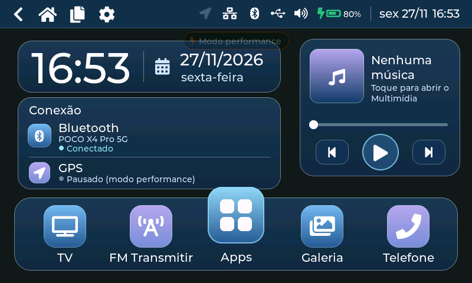
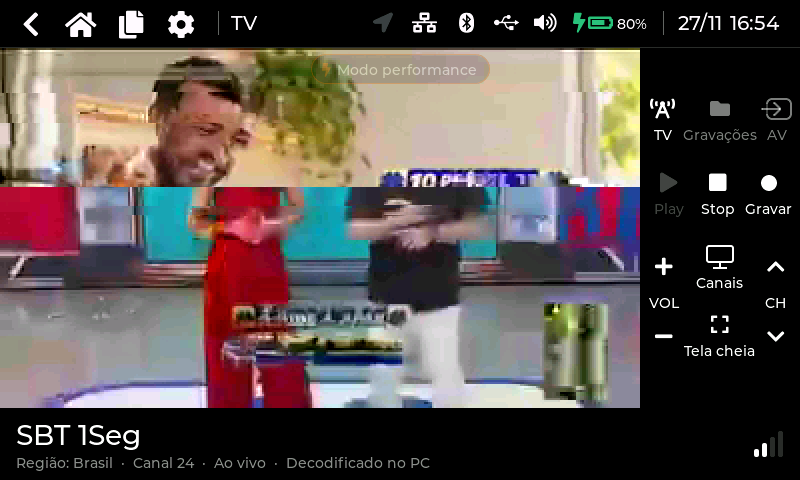
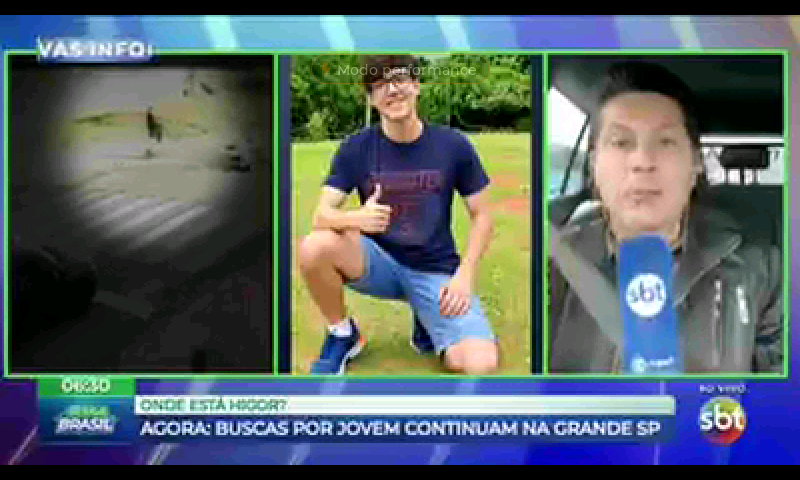
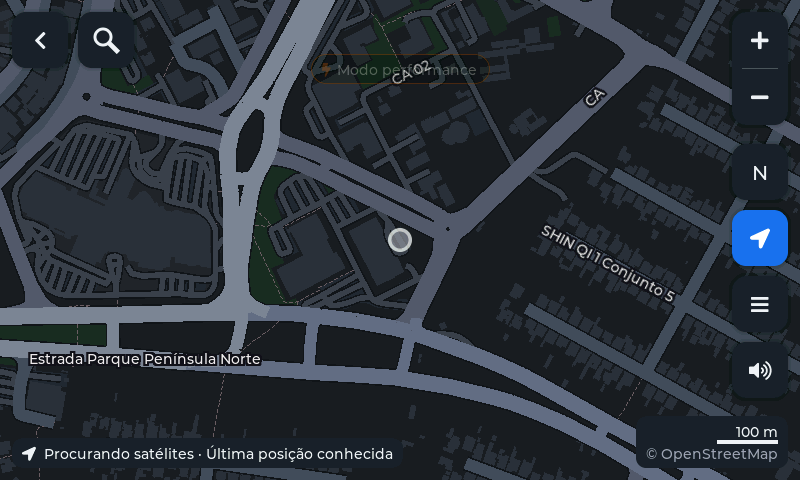
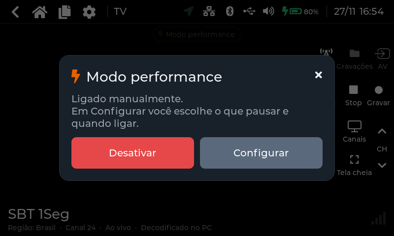
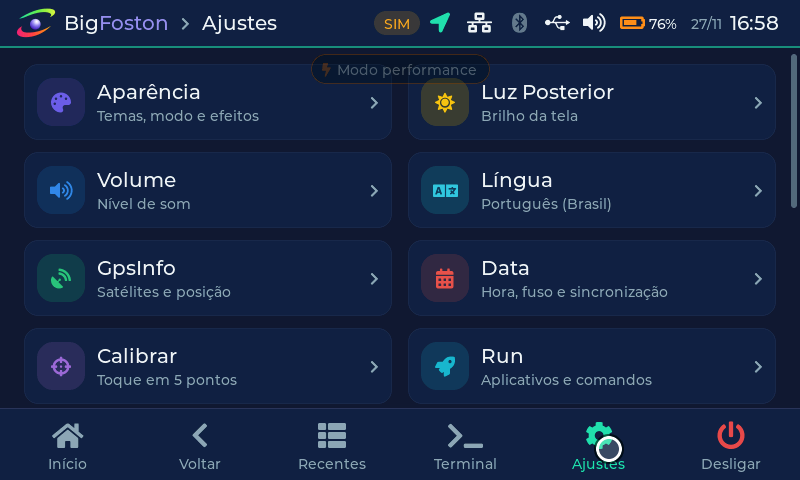
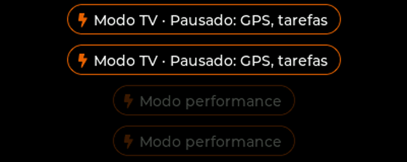

# Etapa 5 — A etiqueta "Modo performance" e o polimento

## A regra

Enquanto o modo performance estiver ligado (ou ligando), **por qualquer motivo**, a etiqueta
"⚡ Modo performance" fica à mostra:
- **sempre no mesmo lugar:** no meio da tela, no topo, um pouco abaixo da barra de cima
  (y = 54). Vale também onde não há barra: Big GPS, TV em tela cheia, vídeo em tela cheia;
- **como uma marca d'água:** quase invisível (~30 % de opacidade);
- **clicável:** um toque a acende e abre o diálogo com Desativar e Configurar, e um ✕ no canto
  superior direito fecha.

Ao desligar o modo, ela some na hora (e o arquivo da marca também).

| Início | Sobre o vídeo da TV | TV em tela cheia |
|---|---|---|
|  |  |  |

| Big GPS (sem barra) | O toque abre o diálogo (✕ no canto) | Ajustes |
|---|---|---|
|  |  |  |

(Capturas do FOSTON, menos Ajustes, que é do simulador. Os blocos na imagem da TV são da recepção
da antena.)

## Por cima de quem desenha direto na tela

Três programas pintam o vídeo direto no framebuffer, onde o LVGL não desenha por cima:
- o player da TV (`bftvd`);
- o motor do Big Remote Play (`bfrp`);
- o vídeo em tela cheia do Internet (no próprio shell, `webremote.c`).

O topo central fica dentro do vídeo nos três, então a etiqueta precisa ir junto com cada quadro:

```
perfui (shell)                       bftvd / bfrp / webremote
  etiqueta à mostra                    depois de cada quadro:
  └─ lv_snapshot da etiqueta  ──►        fbmark_poll  (relê o arquivo se mudou, ≤ a cada 300 ms)
     RGB565 + alfa 0..32               fbmark_apply (mistura só os pontos com alfa, só na região
     /run/bigfoston-mark                              que acabou de ser desenhada)
  modo desligou: apaga o arquivo
```

- **O que é comum aos três:** `src/ui/core/fbmark.h`, só cabeçalho, sem dependências. A mistura é
  RGB565 com 5 bits de alfa, os três canais de uma vez.
- **Custo:** a etiqueta tem ~180×30 pontos. A mistura lê do framebuffer (sem cache) só os pontos
  que ela cobre, uma vez por quadro.
- **Quem redesenha só o que mudou** (o Big Remote Play pelo relay, o vídeo do Internet) precisa
  refazer a área da etiqueta antes de misturar de novo, senão ela escurece a cada quadro sobre a
  imagem parada e fica para trás ao sumir. `fbmark_poll` diz quando a marca apareceu, mudou ou
  sumiu e qual área refazer (a antiga e a nova juntas); o `bfrp` redesenha sempre as linhas da
  etiqueta e o quadro inteiro na mudança; o vídeo do Internet copia a união das áreas uma vez só.
  Coberto por `tests/test_fbmark.c`.
- **A cópia sai igual à da interface,** porque é a própria etiqueta renderizada pelo LVGL
  (`LV_USE_SNAPSHOT`, ligado em `lv_conf.h` e no gerador `tools/make_lv_conf.py`).
- **Um ajuste de passagem no gerador:** ele estava dessincronizado do `lv_conf.h` versionado e
  desligaria o `LV_USE_LINE`, que os ícones da TV usam.

### O diálogo por cima do vídeo

O player redesenha a área do vídeo a cada quadro e apagaria qualquer diálogo: o da etiqueta, uma
chamada recebida, um aviso. Agora, enquanto houver algo à mostra na camada de cima da TV:
1. o shell cria `/run/bigfoston-tv-hold`;
2. o `bftvd` para de desenhar (o som e a decodificação seguem);
3. 150 ms depois, a interface se redesenha por cima.

Ao fechar o diálogo, o arquivo some e o vídeo volta. Na tela cheia, tocar na etiqueta abre o
diálogo e sai da tela cheia (como qualquer aviso).

Medido no aparelho, com uma gravação tocando (para não depender da antena):

| | Quadros em 3 s |
|---|---|
| Tocando | 67 |
| Com o diálogo aberto (contando a partir do arquivo de pausa) | **0** |
| Depois do ✕ | 94 |

Do toque até a pausa: 0,75 s pelo canal de teste, que é lido a cada 300 ms (com o dedo, menos).
Som sem cortes no período todo.

### Quem conta o que está "por cima"

Três telas decidiam pelo que estava visível na camada de cima:
- a TV saía da tela cheia;
- o Internet só usava o vídeo direto sem nada por cima;
- o Big Remote Play parava o vídeo.

Com a etiqueta sempre visível, as três deixariam de funcionar. Todas a ignoram agora
(`perfui_tag_obj`). A etiqueta volta para cima da camada a cada tique (tela cheia, mapa,
teclados), menos quando há um diálogo ou a janela de progresso: esses ficam por cima dela.

## Visual

| Item | Valor |
|---|---|
| Lugar | `LV_ALIGN_TOP_MID`, y = 54 (barra de 48 + 6), igual em toda tela |
| Forma | pílula de 30 px, raio 15, área de toque estendida 10 px |
| Opacidade do conjunto | 77/255 (~30 %); 100 % enquanto apertada |
| Fundo | preto a 50 % (sob os 30 %: um véu leve) |
| Borda | 1 px `#e66100`, a cor do modo em todo o sistema |
| Ícone e texto | ⚡ na cor do modo; "Modo performance" (pt), "Performance mode" (en), "Modo rendimiento" (es), Montserrat 14, branco |
| Entrada | desce 6 px e acende até 30 % em 220 ms, quando as animações valem; nos modos TV e GPS, na hora |
| Aviso de modo | ao entrar no modo TV ou GPS, acende 100 % por 3 s com o que pausou e volta à marca d'água (abaixo) |
| Saída | imediata |

**No tema claro** ela fica mais apagada (branco a 30 % sobre claro). É o comportamento pedido
para uma marca d'água. O véu escuro do fundo e a borda laranja continuam marcando o lugar.

**Ela fica por cima do que estiver ali,** inclusive a faixa da manobra do Big GPS navegando. É
quase transparente e o toque nela só abre o diálogo. A faixa da manobra não recebe toque.

## O diálogo

- Título com o ⚡; o motivo ("Modo TV: …", "Modo GPS: …", "Ligado manualmente."); a dica de
  Configurar.
- **Desativar** (vermelho): desliga até fechar o app que o ligou.
- **Configurar:** abre Ajustes > Modo performance.
- **✕** no canto superior direito (48×48, área de toque estendida) fecha, como o Esc.

O texto do diálogo passou de 300 para 512 bytes: o motivo do modo GPS com a dica não cabia.

## Polimento junto

- **Ajustes > Modo performance:**
  - seção "Modos TV e GPS (plano de eficiência)";
  - resumo ao vivo no cartão de estado ("Pausado: GPS, tarefas · mantido (conectado): Bluetooth,
    Telefone").
- **Rodapé da TV:** "Decodificado no PC" ou "Decodificado no FOSTON".
- **Barra de cima** sem redesenho à toa em todas as telas (etapa 3).

## Aviso ao entrar num modo

Ao entrar no modo TV ou GPS, a própria etiqueta acende por 3 s com o que pausou e depois volta a
ser a marca d'água:




(Capturas seguidas do FOSTON, recortadas no topo.)

- **Na etiqueta, e não num aviso à parte:** um aviso comum fica na camada de cima. Na TV, isso
  pausaria o desenho do vídeo justamente na entrada (o diálogo por cima, acima), e o player o
  apagaria. A etiqueta já é ignorada nessa conta e já vai para cima do vídeo (`fbmark`).
- **O texto** é o mesmo do resumo de Ajustes (`perfui_svc_names`, usado pelas duas telas): o que
  o modo pausa menos o que ficou por estar conectado. Se não couber na cópia para o vídeo
  (`FBMARK_MAX_W`), sai o "Pausado:".
- **Só uma vez por entrada.** Se o modo não ligar em 5 s (desativado, por exemplo), o aviso não
  aparece depois fora de hora. Com a etiqueta desligada em Ajustes, também não.

## Vigia do shell travado

O `S90bigfoston-shell` reinicia o shell que **sai**. Um shell **travado** (laço parado) deixava a
tela congelada, e no carro só desligando. Agora uma thread do próprio shell (`core/watchdog.c`)
confere a cada 5 s se o laço principal continua girando; parado por 45 s, ela registra o motivo e
encerra o processo (código 70), e o `S90bigfoston-shell` o reinicia.

- **Sem custo:** nenhum processo novo, só um contador lido a cada 5 s. Um vigia em script
  precisaria de um processo por segundo (o BusyBox do aparelho não tem `stat`), o mesmo tipo de
  custo que foi tirado do `S10bigfoston`.
- **Folga:** a pior volta do laço medida no aparelho (abrir o mapa, abrir e fechar a TV, Ajustes)
  foi de 537 ms; o limite é uns 80× isso.
- **O vídeo não fica órfão:** o `bftvd` sai junto com o shell (`PR_SET_PDEATHSIG`).
- **Para depurar** com o laço parado (gdb), `BIGFOSTON_NO_WATCHDOG=1`. Só no aparelho: o
  simulador não tem vigia.
- **Teste:** `echo "hang 60" > /run/bigfoston/ctl` para o laço por 60 s. Medido: o shell saiu aos
  50 s (45 s mais a conferência de 5 s), com "laço parado há 45 s, reiniciando" no
  `/var/log/bigfoston-shell.log` e no `dmesg`, e voltou sozinho.
